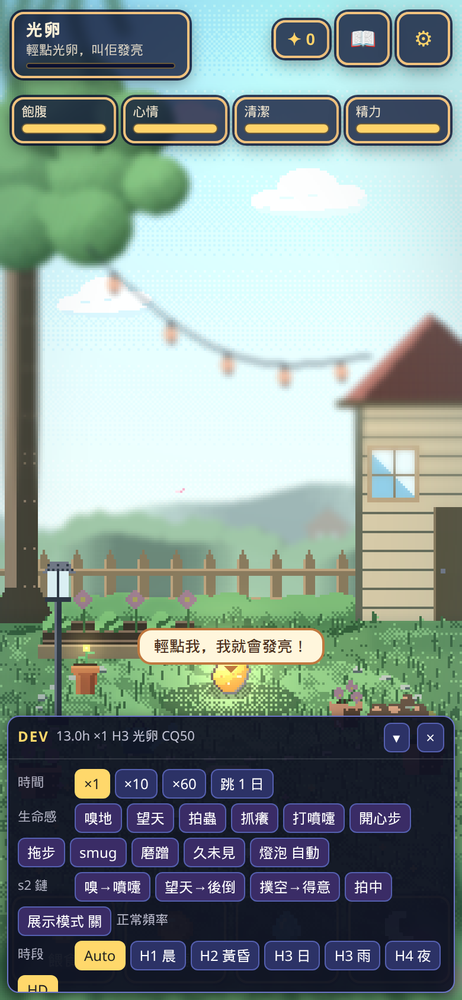
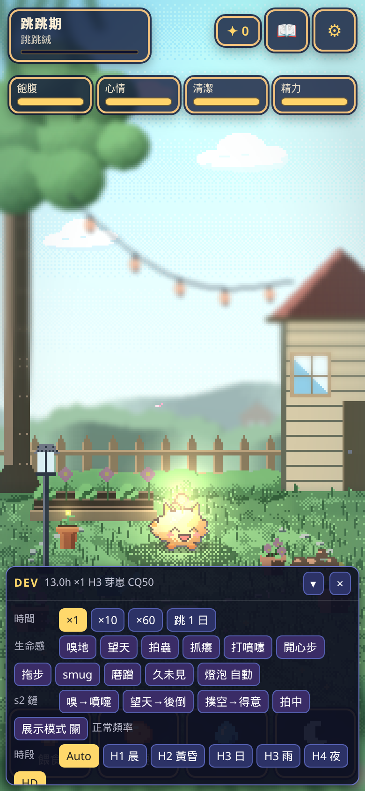
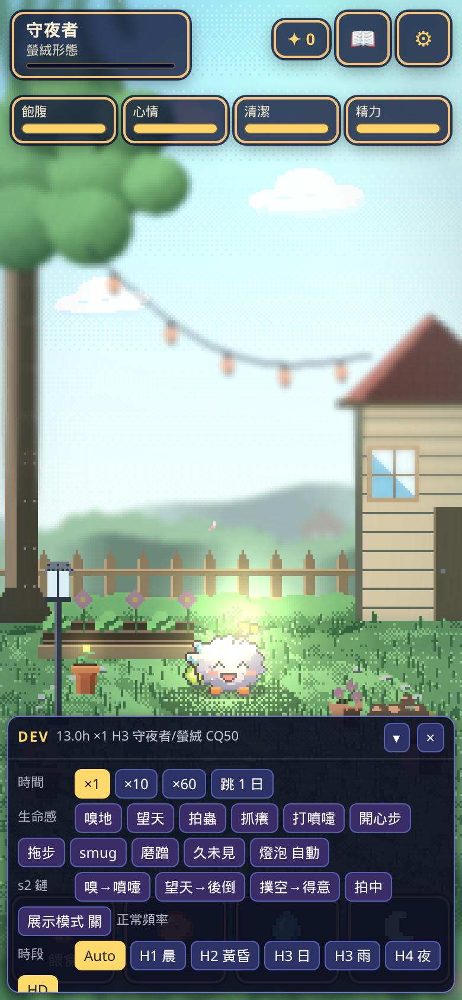
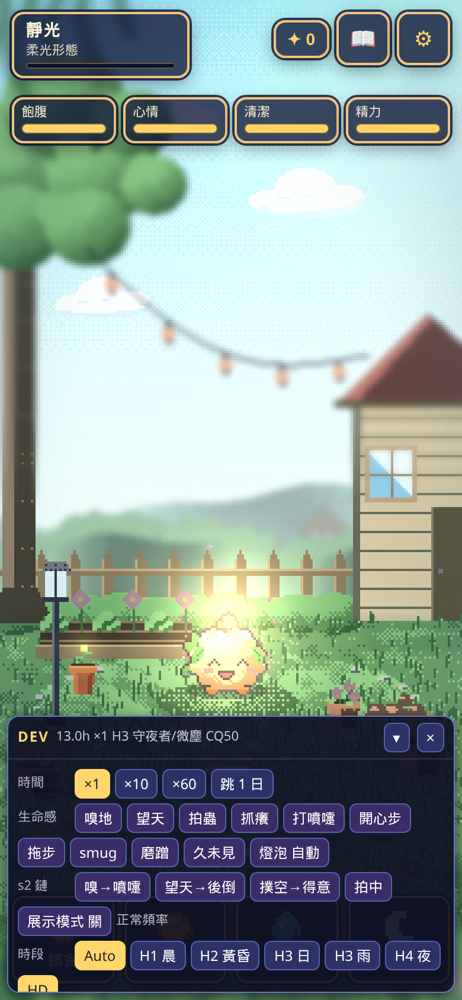

# 生命感 s2（38932e3）

> 被測：`code/glimmer-live-s2` @ `38932e3`（底係 combo `b4a5616`）。單檔未入庫，按 `tools/build-single.py` 打出 `glimmer-live-s2.html`（8.9 MB）再測。頁面時鐘用 `__qa.pet.step`。冇改遊戲碼。APK **冇測**（冇真機）。
> 缺圖 `smug_pose`／`act_cool`／`lookup_tip`／`getup`／蟲仔 sprite 用後備，**唔當缺陷**。後備跑完冇拋錯、冇卡死。

## 1. 小動作（頁面快進 60 分鐘，seed 7，心情 75）

新小動作 15 次：scratch 6、sneeze 6、lookup 2、swat 1。同一款最短間隔 scratch **620 s**、sneeze **625 s**、lookup **2418 s**（≥10 分鐘）。連續兩次相同 **0**。平均 **0.25／分**，峰值 **2／分**（≤2 PASS）。

連眨眼／搖擺／呵欠：193 次（blink 70、sway 68、yawn 43），平均 **3.22／分**、峰值 **7／分**，最短 blink 14.2 s／sway 15.1 s／yawn 11.8 s。呢三款係第一段待機節奏，10 分鐘冷卻唔包佢哋；連續相同仍然 **0**。

心情變體（各 4 seed × 30 分鐘）：心情 90 sway 167、yawn 89、scratch 12；心情 30 sway 105、yawn 144、scratch 12。高心情 sway 多、低心情 yawn 多。

## 2. 行路中途停（≥200 段）

真冷卻下 6 seed × 60 分鐘：**235 段 walk、停 32 次 = 13.6%**（嗅 11、望天 8、拍蟲 13）。接近設計 15%。頁面快進另一組 65 段係 12.3%。

停完返原目標：出發 `tx=55`，停低之後 `tx` 仍係 **55**，行到 x **53.8** 仍然係 `walk`／`resume`，路徑反向次數 **0**。

## 3. 音效（只睇呼叫，冇聽）

抓癢 journal `sfx:scratch`，音訊 log 有 `pet_scratch_a/b`。打噴嚏 `sfx:sneeze`，log 有 `pet_sneeze_a/b`。拍蟲 `sfx:bug_pat` → `pet_bug_pat_a`。a/b 有交替。

## 4. 心情步姿（1 秒位移）

普通 walk **+12.38**（show `walk`）。心情 95 **+14.23**（`walk_happy`，×1.15）。精力 20 **+7.43**（`walk_drag`，×0.60）。

## 5. 蠢蠢地鏈

| 強制 | 順序 | 結果 |
|---|---|---|
| 撲空 | notice → swat → **smug** | 得意段用 `emo_happy`＋瞇眼；蟲仔 `flee`。得意段點一下 → `startle`，唔卡。 |
| 嗅到噴嚏 | sniff → sneeze → **act_cool** | 冷靜段身體係 `sway`。 |
| 望天後仰 | lookup → tip → **getup** → act_cool | 起身用 `wake`。後仰 pose 有數。 |

三條都行完，冇卡喺 `micro`。swat／sneeze 出手段設計上唔俾點打斷（單元測試有守）。

手機畫面個寵物細，得意／後仰主要靠臉同少少傾斜，序列本身清楚。缺圖後備唔破壞。

## 6. 舊行為同經濟

`grumpy_tap`：id 正確、冷卻 **48h**、光粒 **0**、`dayCount` 唔加、DEV 唔開。名牌 1.5 秒內 5 下開到 DEV。橫向「請轉直向」。

3000 日 × 8 seed：池 **2.254–2.391**，總 **≤2.834**，彩虹平均 **12.72–12.80**，最長隔日 **14.047**（新規格 PASS），冷卻違規 **0**，14 日日記 **31.04**。

| 套件 | 通過 | 失敗 | skip |
|---|---|---|---|
| behavior | 126 | 0 | 0 |
| events | 161 | 0 | 0 |
| sim | 85 | 0 | 0 |
| audio | 41 | 0 | 0 |
| e2e-live2 | 37 | 0 | 0 |
| e2e-s1 | 51 | 0 | 0 |
| e2e-hd2d | 51 | 0 | 0 |
| e2e-live | 45 | 0 | 0 |
| e2e-a | 94 | 0 | 0 |

## 7. 效能同版面

4× CPU、約 8 秒：高畫質平均 **16.74 ms**、p95 **16.8**、long task **4**；低畫質 **16.64／16.7**、long task **4**。Console error **0**。直向 390 清晰畫面鋪滿；橫向 rotate `flex`。

## 仍未收

| 級 | 項 | 修法 |
|---|---|---|
| **P2** | 「生命感第二段」強制掣只喺 `?debug=1` 嘅 DBG。名牌 5 下／`?dev=1` 開嘅 DEV 抽屜冇呢組（`devHasGroup` false）。 | 同一組掣加落 `devpanel.js`。 |

冇 P0／P1。APK 未測。

## s2b（16eaf75）

名牌 5 下開 DEV。8 個即刻掣都見到，而且撳完真係出動作：嗅地 `sniff`、望天 `lookup`、拍蟲 `idle>swat>smug_pose`、抓癢 `scratch`、打噴嚏 `sneeze>emo_surprised>act_cool`、開心步 `walk_happy`、拖步 `walk_drag`、smug `smug_pose`。

`glimmer.liveDemo` 預設係 `null`，`liveDemo` **關**。關住快進 60 分鐘：新小動作 16 次，平均 **0.267／分**，峰值 **2**（≤2 PASS）。

經濟同上一輪一樣：池 2.254–2.391，總 ≤2.834，彩虹 12.72–12.80，日記 31.04，冷卻 0。套件全 0 失敗、0 skip：behavior 151、events 161、sim 85、audio 43、e2e-s2b 25、e2e-live2 43、e2e-s1 51、e2e-hd2d 51、e2e-live 45、e2e-a 94、e2e-playwright 37。4× CPU 平均 **16.65 ms**、p95 **16.7**。橫向「請轉直向」。Console error **0**。

上一輪 P2（掣只喺 DBG）已收。冇新 P0／P1／P2。APK 未測。

## s3（5900272）

名牌 5 下 DEV：舊 8 掣仲喺，新 3 掣（磨蹭／久未見／燈泡）撳咗都會走。磨蹭掣：`rub → purr → end → blank → act_cool`。久未見掣次序：`rush_start → rush → brake → act_cool → back → reunion_happy → stay`。最左去到 x **-19**（衝過頭 14 再滑 5），煞停時 x **-14**。四步都有播。`nuzzle_purr`／`reunion_happy` 用後備，唔當缺陷。

長按起點：390 ms 未蹭（記 hold、唔轉身、光粒 0、鬧 0）；410 ms 入 `nuzzle`／`rub`，未呼嚕。1.19 s 同 1.21 s 都仲係 `rub`，**未呼嚕**。去到約 1.70 s 先 `purr`（12 次都有）。鬆手 `act_cool`：1.21 s 單次有；1.75 s 12 次得 **11** 次（`nuzzleCool` 75%）。取消手勢停喺 stay、冇獎。拖離身但未離畫面：磨蹭繼續，鬆手冇光粒、冇鬧。多指：兩指都放咗，2 秒後仍然 `nuzzle`／`purr`、`nuzzleHeld` true，並且記咗一次短 tap（冇轉身、冇光粒、冇鬧）。

離線：3 h、5.9 h 唔衝；**6.0 h 同 7.9 h 都會排重逢**（門檻係 `reunionAwayH` 6，唔係 8）。8 h 會衝。同日第二次 skip `today`；日子鍵係尋日就再衝。時鐘被改（`lastSaveTime` 超前）skip `tampered`；`lastSeen` 喺未來 skip `short`。`dayCount` 已經 4，8 h 仍然排隊，日數唔加；開發者重逢唔改 cq／光粒／日數。8 h 光粒 +8 係原本離線鐘點禮，唔係衝過嚟另加。

燈泡剛好 **5** 色：happy `#FFD45E`、neutral `#FFEFC4`、sleepy `#8F85C2`、hungry `#F2A65A`、grumpy `#E5584D`。掣循環同自動（飽／餓／眼瞓／鬧）對得上，抽樣冇跳心情，色差 ≤1。臉同燈泡同一幀都有畫。

`glimmer.liveDemo` 預設關。關住新小動作 **0.267／分**（峰 **2**）。直向 390×844 畫面鋪滿，寵物觸控 **108×110** CSS，`.ibtn` 最小 **45**。橫向 844 同 915 都有「請轉直向」。4× CPU 平均 **16.68 ms**、p95 **16.8**。Console error **0**。經濟同 s2b 一樣（池 2.254–2.391，總 ≤2.834，彩虹 12.72–12.80，日記 31.04，冷卻 0）。

e2e-s1 650 ms 長按而家係磨蹭，套件預期已改，51 通過，唔當缺陷。

| 套件 | 通過 | 失敗 | skip |
|---|---|---|---|
| behavior | 177 | 0 | 0 |
| events | 161 | 0 | 0 |
| sim | 85 | 0 | 0 |
| audio | 46 | 0 | 0 |
| e2e-s3 | 27 | 0 | 0 |
| e2e-s2b | 25 | 0 | 0 |
| e2e-live2 | 43 | 0 | 0 |
| e2e-s1 | 51 | 0 | 0 |
| e2e-hd2d | 51 | 0 | 0 |
| e2e-live | 45 | 0 | 0 |
| e2e-a | 94 | 0 | 0 |
| e2e-playwright | 37 | 0 | 0 |

| 級 | 項 | 修法 |
|---|---|---|
| **P1** | 呼嚕唔係按住 1.2 s 就開始。1.21 s 仍然 `rub`；要磨蹭開始之後再計 1.2 s（總按住約 1.6 s）。 | `purrAfterSec` 改 0.8，或者由手指落下計滿 1.2 s。 |
| **P1** | 重逢門檻係 6 h。7.9 h 都會衝。 | 若規格係 8 h，`reunionAwayH` 改 8，並改 e2e「<6h」呢句。 |
| **P1** | 多指放開之後 `nuzzleHeld` 仍然 true，會呼嚕到 12 s 上限。 | 新指落下先結束舊按；全部指頭抬起先當鬆手。 |
| **P2** | 長按夠耐鬆手只係約 75% 接 `act_cool`（12 次得 11）。 | 呼嚕之後鬆手強制扮冷靜，或者規格寫明 75%。 |

冇 P0。APK 未測。

## s3 再測（4cd86cf）

鎖定規格。50 次呼嚕後鬆手：**50／50** `act_cool`，身體係真 `nuzzle_purr`（live）。1.19 s 仍然 `rub`、鬆手 `idle`；1.21 s 入 `purr`／`nuzzle_purr`，鬆手 `cool`。390 ms 未蹭。1.00 s 有蹭、未呼嚕、冇 `act_cool`。冷卻鍵預先寫滿都出到 `act_cool`。

重逢：3 h、7.9 h 唔衝；8.0 h 會排（T 28800）；同日再嚟 skip `today`。次序 `rush_start → rush → brake → act_cool → back → reunion_happy`，`show` 係真 `reunion_happy`。多指：抬一隻仍然 `nuzzleHeld`；全部抬起先停。`pointercancel` 當鬆手，呼嚕後一樣 `act_cool`。

`liveDemo` 預設關。新小動作 **0.20／分**（峰 **2**）。DEV 11 掣都喺。4× CPU **16.62 ms**。橫向有「請轉直向」。Console error **0**。經濟同之前一樣（池 2.254–2.391，日記 31.04，冷卻 0）。套件全 0 失敗、0 skip：behavior 187、events 161、sim 85、audio 46、e2e-s3 32、e2e-s2b 25、e2e-live2 43、e2e-s1 51、e2e-hd2d 51、e2e-live 45、e2e-a 94、e2e-playwright 37。

上一輪三個 P1 同一個 P2 都收。冇新 P0／P1／P2。

## evo6（881a528）

倉庫 **冇** `pet-template-v1.md`。時長對住 `data.js` 聲稱嘅 §6；尺寸對住 `CLIPS.md` 同 atlas。全部一致。

| 階段 | 時長（實際） | 尺寸／pivot（實際＝CLIPS） |
|---|---|---|
| 光卵 | 10 分 | 24／(12, 21) |
| 絨點 | 6 h | 28／(14, 25) |
| 芽崽 | 18 h | 32／(16, 29) |
| 跳跳期 | 3 日 | 38／(19, 35) |
| 守夜者 ×4 | 7 日 | 44／(22, 41) |
| 靜光 ×4 | 4 日 | 48／(24, 45) |

分支：CQ 54＋條件齊 → 柔光；55 → 螢絨。69 → 柔光；70 → 燦光。39 → 微塵；40 → 柔光。夜 39% → 燦光；40% → 螢絨。冇螢火、或者螢火只喺絨點 → 唔係螢絨。條件齊又 CQ 95 → 螢絨優先過燦光。

舊檔：光粒同 CQ 保留。`radiant` → `bright`。芽崽 2 h → 絨點。爛 JSON 返回 null，冇爆。

離線：光卵離開 72 h → 絨點（成長 5.83 h），受 24 h／50% 上限，一次最多約 6 h 成長，所以跨唔到兩級。芽崽剩 1 h 會入跳跳期。改時鐘（超前／`lastSeen` 喺未來）成長唔加。

化光：紀念係螢絨第 1 代，新光卵 gen 2，光粒 15 重載仲喺。

直向六階同四條分支都畫到，名牌啱。重載保持靜光／螢絨。名牌 5 下開到階段掣同分支掣。4 個種子 × 6 個時間表冇跳級。到靜光／化光（日，平均）：勤力 12.63／17.31，普通 11.98／16.34，返工 12.70／17.18，輕度 15.12／20.20，早起 25.40／34.40。隔日 45 日內到守夜者（20.71 日），未到靜光（不適會暫停成長）。經濟同 s3 一樣。呢版 1.19 s 未呼嚕、1.21 s 呼嚕後 `act_cool`。4× CPU **16.69 ms**。橫向有轉直提示。Console error **0**。evo6 測試 115 通過。佔位動畫唔當缺陷。

冇新 P0／P1／P2。APK 未測。

## evo6 再測（f4102b6）

靜光消耗 ≤ 守夜者。`stageDecayMul` 兩邊都係 **1**。evo6 測試 **120** 通過、0 失敗，包括新 5 項（倍率 1 項＋瞓／唔瞓 × 便便 0／2 共 4 項）。六個時間表 × 4 種子，守夜者同靜光各抽一次同條件 1 分鐘：飢餓／心情／清潔／精力消耗全部靜光 ≤ 守夜者（違規 **0**）。隔日未自然行到靜光，用同一身體狀態強制對比，同樣過。

分支、遷移、化光、時長尺寸冇改。經濟參數冇改數，沿用上一輪（池 2.254–2.391，日記 31.04，冷卻 0）。直向同 4× CPU **16.69 ms**、console **0** 沿用上一輪。離線成長上限而家係 6 小時（一次最多升一階）係已知待改做 24 小時，唔當今次新問題。

冇新 P0／P1／P2。

## 浮動層（cbb2960）

冇真機，冇 Android SDK，gradle 冇跑。對上一個提交 `b7a203a`，Kotlin 公開功能冇刪：懸浮服務、開關、拖、單擊／雙擊、長按選單（貼邊／自由／釘住）、釘位同模式持久、通知、打盹、行路、互動 queue、返 app 回放。只係移除 `ProfileInstallReceiver`（帶 DUMP 權限）。

`sizeDp` 唔喺 atlas json。bridge 有 `evo.overlayInfo()` 就寫 snapshot **v2**（stage／evoForm／size／pivot／sizeDp）。六階都有：光卵 39、絨點 46、芽崽 52、跳跳期 **62**（61.75 四捨五入）、守夜者 72、靜光 78。

縮放：`max(1, round(sizeDp × density ÷ atlas 像素))`。三個例子喺 density **2.625**（420 dpi）一致：光卵 39÷32 → **3**，跳跳期 62÷32 → **5**（用 61.75 都係 5），靜光 78÷64 → **3**。其他 dpi 整數會變，公式一樣。

冇 `sizeDp` 嘅 v1：form 係 sprout → 52 dp，否則 72 dp。`null`、爛 JSON、0、負數、非數字都落入呢個後備，外層 `catch`，唔會炸。

已知、唔當缺陷：螢絨／微塵 overlay 用 soft atlas（`formOf`）。同一 form 轉階段（光卵→跳跳期、守夜者→靜光）要關再開先更新尺寸，等 Kurt。

冇新 P0／P1／P2。APK 未測。

## evo6 離線上限（ee9d258）

`docs-gdd/pet-template-v1.md` §6 同程式一致。

| 階段 | 時長 | 尺寸 | pivot |
|---|---|---|---|
| 光卵 | 10 分 | 24 | (12, 21) |
| 絨點 | 6 小時 | 28 | (14, 25) |
| 芽崽 | 18 小時 | 32 | (16, 29) |
| 跳跳期 | 3 日 | 38 | (19, 35) |
| 守夜者 | 7 日 | 44 | (22, 41) |
| 靜光 | 4 日 | 48 | (24, 45) |

§6 補充：入帳 `min(離開, 24h)`，唔係要夠 24 小時先准升級。芽崽 90%（剩 1.8 小時）＋離線 2 小時 → 跳跳期、進度 **0**。絨點 90%＋2 小時 → 芽崽、進度 0。跳跳期 0%＋23.9 小時 → 仍然跳跳期，進度 **23.9 小時**（有入帳，唔係被 24 小時門檻擋住）。芽崽 0%＋23.9 小時 → 升一階（18＜23.9），進度 0。跳跳期 0%＋24／30／200 小時只入帳 24 小時，未夠 3 日所以唔升。200 小時需求最低 **20.8**（≥20）。靜光尾離線 `fadeReady` **1** 次，再離線唔重複。

evo6 測試 **136／0**（分支、遷移、化光都喺入面）。經濟同之前一樣（池 2.254–2.391，彩虹 12.66–12.77，日記 31.04，冷卻 0）。直向 390×844，4× CPU **16.7 ms**。橫向有「請轉直向」。Console error **0**。

24 小時係上限，唔係門檻。冇新 P0／P1／P2。

## 浮動層即時縮放（0355117）

`needSwap`：form 唔同，或者同一 form 計出嚟嘅 scale 唔同，先 `swapForm`。`tick` 唔會叫佢。snapshot 冇變 scale 就唔 `updateViewLayout`，唔會每幀重加視窗。`swapForm` 用 `updateViewLayout`，腳位 `feetX／feetY` 留低。舊功能（拖、點、選單、釘、通知、queue）冇刪。

冇真機。冇新 P0／P1／P2。APK 未測。

## evo6 overlayStatus（67f98b5）

`G.evo.overlayStatus()` 只讀。十個階段／分支：`egg` 旗同階段一致，`evoForm` 同 `D.evoForm` 一致，唔改狀態。肚餓 22 低過 30 先出 `urgent`。

| 套件 | 通過 | 失敗 |
|---|---|---|
| overlay-status | 14 | 0 |
| evo6 | 136 | 0 |
| behavior | 187 | 0 |
| events | 161 | 0 |
| sim | 85 | 0 |
| audio | 46 | 0 |

分支次序、螢絨、24 小時上限、每次最多升 1 階、§6 尺寸都喺 evo6 套件入面。冇回歸。

## 浮動層（fecb0ea，含 a528c7f）

冇真機、冇 Android SDK，gradle 冇跑。`fpet-bridge.test.js` **10／0**。`PetStatusTest` 係 JUnit，呢度跑唔到。

簽名：有 key 先用 release key，v1＋v2＋v3。`release` 冇寫 `debuggable`，AGP 預設 false。冇 key 就用 debug key 簽 release。權限仍然係 INTERNET、SYSTEM_ALERT_WINDOW、FOREGROUND_SERVICE、FOREGROUND_SERVICE_SPECIAL_USE、POST_NOTIFICATIONS、REQUEST_IGNORE_BATTERY_OPTIMIZATIONS。DUMP receiver 仍然刪走。冇新權限。

v3：心情 `happy／ok／sad`、`sleeping`、最急需求 **低過 30** 先 `urgent`（30 唔出）。氣泡用 `need_*`。v1／v2／爛 JSON：`project` 返回中性或者 `catch` 變 null，唔炸。

拋出：速度上限 `dp(2600)`，摩擦減速，低過 `dp(40)` 就停。腳位夾喺安全區，撞邊速度打 0.6 反向，飛唔出畫面。邊位坐係 `MODE_EDGE` 行去左右角。撚一下 `turn_back`，跟心情開心／唔開心。玩圖示預設 `4x6`，可以揀 `off`。

舊路仲喺：snapshot 變就 `needSwap`、整數 `scale`、螢絨／微塵用 soft atlas。`fadeReady` 喺遊戲側（evo6 套件有），浮動 snapshot 冇呢個欄。

直向：冇寫死橫向寬高。API 30 用 `currentWindowMetrics`。

| 級 | 項 | 修法 |
|---|---|---|
| **P2** | 長按選單列同玩圖示 radio 係 **44dp**，低過 48dp。設定主掣係 48dp。 | `minHeight` 改 `48dp`。 |

冇 P0／P1。APK 未測。

## 浮動層再測（6fc62ed）

長按選單列同玩圖示 radio 而家係 **48dp**。仲低過 48dp 嘅得「活動模式」三粒 radio（沿底邊行／自由行／定點）**44dp**。呢個係已知 P2，遊程另改。設定主掣同省電頁掣仍然 48dp。

`MainActivity` 加咗 `android:screenOrientation="portrait"`。`PetOverlayService` 對 `fecb0ea` 只改選單高度，拋出、撞邊、邊坐、撚、`needSwap`、整數 scale 冇郁。

簽名仍然 v1＋v2＋v3，release 預設非 debuggable。權限冇加，DUMP 仍然刪。v3 低過 30 先出需求。玩圖示預設 4×6，可揀唔玩。螢絨／微塵仍然 soft atlas。`fadeReady` 仍然喺遊戲側，浮動 snapshot 冇呢欄。bridge 測試 **10／0**。API 30 路徑冇改。

冇新 P0／P1。已知 P2 未收。APK 未測。

## 浮動層再測（1648f8a）

活動模式三粒 radio 而家係 **48dp**。全 repo 觸控件：長按選單、活動模式 radio、玩圖示 radio、設定掣、省電頁掣都係 48dp。冇再低過 48dp 嘅掣。`dp(40)` 係拋出停速同行路距離，唔係觸控。

`MainActivity`、`SettingsActivity`、`PowerGuideActivity` 都有 `screenOrientation="portrait"`。`PetOverlayService` 對 `6fc62ed` 冇改。簽名、權限、v3、拋出、邊坐、撚、4×6、soft atlas、`fadeReady` 無回歸。bridge 測試 **10／0**。API 30 路徑冇改。

已知 P2 已收。冇新 P0／P1／P2。APK 未測。

## evo6 overlayStatus v4（62d6e49）

`info` 有名、階段名、形態名、`evoForm`、進度、幾日大、`fadeReady`。只讀。光卵 `evo_egg`，守夜者微塵 `evo_guard_dust`，靜光螢絨 `evo_still_lumi`，燦光 `evo_guard_radiant`。

| 套件 | 通過 | 失敗 |
|---|---|---|
| overlay-status | 24 | 0 |
| evo6 | 136 | 0 |
| behavior | 187 | 0 |
| events | 161 | 0 |
| sim | 85 | 0 |
| audio | 46 | 0 |

冇回歸。

## 浮動層 v4（afa9cae）

12 套 evo atlas 都齊（json＋webp），唔使 fallback 去舊圖：光卵、絨點、絨芽、絨跳、守夜者四支、靜光四支。唯一 clip fallback 係光卵：`walk` 等退回 idle（已知蛋唔行）。唔認得嘅 `evoForm`、v1 冇 `evoForm`、APK 缺檔，先退 `sprout`／`radiant`／`soft`，否則 `soft`。

`needSwap` 先比 form 字串。守夜者柔光同螢絨都係 44px、scale 一樣，字串唔同就即刻換圖。

長按狀態區闊 **248dp**，加選單 padding 12dp ＝ 260dp，細過直向最短約 320dp，位置再夾喺安全區。五個選項同活動模式 radio 都係 48dp。需求名嗰欄 44dp 係字闊，唔係掣。

v4 有階段名同進度。v3 有心情、冇進度。v2 寫「開返遊戲同步狀態」。v1／null 只得「團絨」。parse 失敗返回 null。`fadeReady` 會出「準備化光」。

三個 Activity 仍然鎖直向。簽名、權限、低過 30 先出氣泡、拋出、邊坐、撚、玩圖示 4×6 無回歸。bridge 測試 **14／0**。冇 SDK，JUnit 冇跑。冇燈泡光暈係已知。

冇新 P0／P1／P2。APK 未測。
