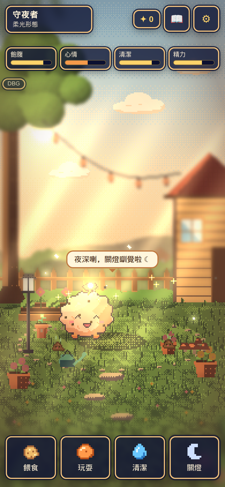
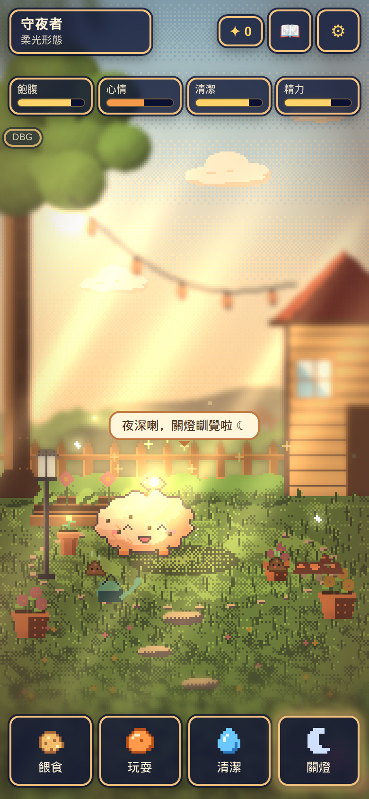
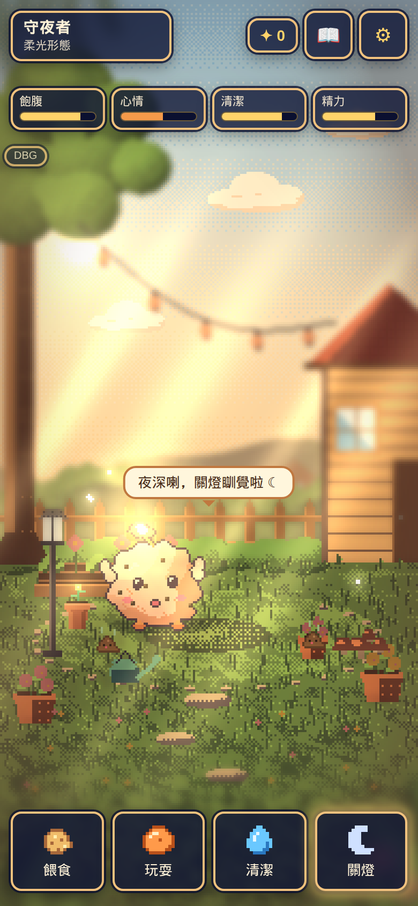
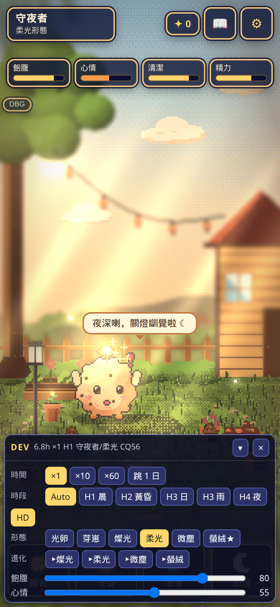

# 生命感 s2（38932e3）

> 被測：`code/glimmer-live-s2` @ `38932e3`（底係 combo `b4a5616`）。單檔未入庫，按 `tools/build-single.py` 打出 `glimmer-live-s2.html`（8.9 MB）再測。頁面時鐘用 `__qa.pet.step`。冇改遊戲碼。APK **冇測**（冇真機）。
> 缺圖 `smug_pose`／`act_cool`／`lookup_tip`／`getup`／蟲仔 sprite 用後備，**唔當缺陷**。後備跑完冇拋錯、冇卡死。

## 1. 小動作（頁面快進 60 分鐘，seed 7，心情 75）

新小動作 15 次：scratch 6、sneeze 6、lookup 2、swat 1。同一款最短間隔 scratch **620 s**、sneeze **625 s**、lookup **2418 s**（≥10 分鐘）。連續兩次相同 **0**。平均 **0.25／分**，峰值 **2／分**（≤2 PASS）。

連眨眼／搖擺／呵欠：193 次（blink 70、sway 68、yawn 43），平均 **3.22／分**、峰值 **7／分**，最短 blink 14.2 s／sway 15.1 s／yawn 11.8 s。呢三款係第一段待機節奏，10 分鐘冷卻唔包佢哋；連續相同仍然 **0**。

心情變體（各 4 seed × 30 分鐘）：心情 90 sway 167、yawn 89、scratch 12；心情 30 sway 105、yawn 144、scratch 12。高心情 sway 多、低心情 yawn 多。

## 2. 行路中途停（≥200 段）

真冷卻下 6 seed × 60 分鐘：**235 段 walk、停 32 次 = 13.6%**（嗅 11、望天 8、拍蟲 13）。接近設計 15%。頁面快進另一組 65 段係 12.3%。

停完返原目標：出發 `tx=55`，停低之後 `tx` 仍係 **55**，行到 x **53.8** 仍然係 `walk`／`resume`，路徑反向次數 **0**。

## 3. 音效（只睇呼叫，冇聽）

抓癢 journal `sfx:scratch`，音訊 log 有 `pet_scratch_a/b`。打噴嚏 `sfx:sneeze`，log 有 `pet_sneeze_a/b`。拍蟲 `sfx:bug_pat` → `pet_bug_pat_a`。a/b 有交替。

## 4. 心情步姿（1 秒位移）

普通 walk **+12.38**（show `walk`）。心情 95 **+14.23**（`walk_happy`，×1.15）。精力 20 **+7.43**（`walk_drag`，×0.60）。

## 5. 蠢蠢地鏈

| 強制 | 順序 | 結果 |
|---|---|---|
| 撲空 | notice → swat → **smug** | 得意段用 `emo_happy`＋瞇眼；蟲仔 `flee`。得意段點一下 → `startle`，唔卡。 |
| 嗅到噴嚏 | sniff → sneeze → **act_cool** | 冷靜段身體係 `sway`。 |
| 望天後仰 | lookup → tip → **getup** → act_cool | 起身用 `wake`。後仰 pose 有數。 |

三條都行完，冇卡喺 `micro`。swat／sneeze 出手段設計上唔俾點打斷（單元測試有守）。

手機畫面個寵物細，得意／後仰主要靠臉同少少傾斜，序列本身清楚。缺圖後備唔破壞。

## 6. 舊行為同經濟

`grumpy_tap`：id 正確、冷卻 **48h**、光粒 **0**、`dayCount` 唔加、DEV 唔開。名牌 1.5 秒內 5 下開到 DEV。橫向「請轉直向」。

3000 日 × 8 seed：池 **2.254–2.391**，總 **≤2.834**，彩虹平均 **12.72–12.80**，最長隔日 **14.047**（新規格 PASS），冷卻違規 **0**，14 日日記 **31.04**。

| 套件 | 通過 | 失敗 | skip |
|---|---|---|---|
| behavior | 126 | 0 | 0 |
| events | 161 | 0 | 0 |
| sim | 85 | 0 | 0 |
| audio | 41 | 0 | 0 |
| e2e-live2 | 37 | 0 | 0 |
| e2e-s1 | 51 | 0 | 0 |
| e2e-hd2d | 51 | 0 | 0 |
| e2e-live | 45 | 0 | 0 |
| e2e-a | 94 | 0 | 0 |

## 7. 效能同版面

4× CPU、約 8 秒：高畫質平均 **16.74 ms**、p95 **16.8**、long task **4**；低畫質 **16.64／16.7**、long task **4**。Console error **0**。直向 390 清晰畫面鋪滿；橫向 rotate `flex`。

## 仍未收

| 級 | 項 | 修法 |
|---|---|---|
| **P2** | 「生命感第二段」強制掣只喺 `?debug=1` 嘅 DBG。名牌 5 下／`?dev=1` 開嘅 DEV 抽屜冇呢組（`devHasGroup` false）。 | 同一組掣加落 `devpanel.js`。 |

冇 P0／P1。APK 未測。

## s2b（16eaf75）

名牌 5 下開 DEV。8 個即刻掣都見到，而且撳完真係出動作：嗅地 `sniff`、望天 `lookup`、拍蟲 `idle>swat>smug_pose`、抓癢 `scratch`、打噴嚏 `sneeze>emo_surprised>act_cool`、開心步 `walk_happy`、拖步 `walk_drag`、smug `smug_pose`。

`glimmer.liveDemo` 預設係 `null`，`liveDemo` **關**。關住快進 60 分鐘：新小動作 16 次，平均 **0.267／分**，峰值 **2**（≤2 PASS）。

經濟同上一輪一樣：池 2.254–2.391，總 ≤2.834，彩虹 12.72–12.80，日記 31.04，冷卻 0。套件全 0 失敗、0 skip：behavior 151、events 161、sim 85、audio 43、e2e-s2b 25、e2e-live2 43、e2e-s1 51、e2e-hd2d 51、e2e-live 45、e2e-a 94、e2e-playwright 37。4× CPU 平均 **16.65 ms**、p95 **16.7**。橫向「請轉直向」。Console error **0**。

上一輪 P2（掣只喺 DBG）已收。冇新 P0／P1／P2。APK 未測。

## s3（5900272）

名牌 5 下 DEV：舊 8 掣仲喺，新 3 掣（磨蹭／久未見／燈泡）撳咗都會走。磨蹭掣：`rub → purr → end → blank → act_cool`。久未見掣次序：`rush_start → rush → brake → act_cool → back → reunion_happy → stay`。最左去到 x **-19**（衝過頭 14 再滑 5），煞停時 x **-14**。四步都有播。`nuzzle_purr`／`reunion_happy` 用後備，唔當缺陷。

長按起點：390 ms 未蹭（記 hold、唔轉身、光粒 0、鬧 0）；410 ms 入 `nuzzle`／`rub`，未呼嚕。1.19 s 同 1.21 s 都仲係 `rub`，**未呼嚕**。去到約 1.70 s 先 `purr`（12 次都有）。鬆手 `act_cool`：1.21 s 單次有；1.75 s 12 次得 **11** 次（`nuzzleCool` 75%）。取消手勢停喺 stay、冇獎。拖離身但未離畫面：磨蹭繼續，鬆手冇光粒、冇鬧。多指：兩指都放咗，2 秒後仍然 `nuzzle`／`purr`、`nuzzleHeld` true，並且記咗一次短 tap（冇轉身、冇光粒、冇鬧）。

離線：3 h、5.9 h 唔衝；**6.0 h 同 7.9 h 都會排重逢**（門檻係 `reunionAwayH` 6，唔係 8）。8 h 會衝。同日第二次 skip `today`；日子鍵係尋日就再衝。時鐘被改（`lastSaveTime` 超前）skip `tampered`；`lastSeen` 喺未來 skip `short`。`dayCount` 已經 4，8 h 仍然排隊，日數唔加；開發者重逢唔改 cq／光粒／日數。8 h 光粒 +8 係原本離線鐘點禮，唔係衝過嚟另加。

燈泡剛好 **5** 色：happy `#FFD45E`、neutral `#FFEFC4`、sleepy `#8F85C2`、hungry `#F2A65A`、grumpy `#E5584D`。掣循環同自動（飽／餓／眼瞓／鬧）對得上，抽樣冇跳心情，色差 ≤1。臉同燈泡同一幀都有畫。

`glimmer.liveDemo` 預設關。關住新小動作 **0.267／分**（峰 **2**）。直向 390×844 畫面鋪滿，寵物觸控 **108×110** CSS，`.ibtn` 最小 **45**。橫向 844 同 915 都有「請轉直向」。4× CPU 平均 **16.68 ms**、p95 **16.8**。Console error **0**。經濟同 s2b 一樣（池 2.254–2.391，總 ≤2.834，彩虹 12.72–12.80，日記 31.04，冷卻 0）。

e2e-s1 650 ms 長按而家係磨蹭，套件預期已改，51 通過，唔當缺陷。

| 套件 | 通過 | 失敗 | skip |
|---|---|---|---|
| behavior | 177 | 0 | 0 |
| events | 161 | 0 | 0 |
| sim | 85 | 0 | 0 |
| audio | 46 | 0 | 0 |
| e2e-s3 | 27 | 0 | 0 |
| e2e-s2b | 25 | 0 | 0 |
| e2e-live2 | 43 | 0 | 0 |
| e2e-s1 | 51 | 0 | 0 |
| e2e-hd2d | 51 | 0 | 0 |
| e2e-live | 45 | 0 | 0 |
| e2e-a | 94 | 0 | 0 |
| e2e-playwright | 37 | 0 | 0 |

| 級 | 項 | 修法 |
|---|---|---|
| **P1** | 呼嚕唔係按住 1.2 s 就開始。1.21 s 仍然 `rub`；要磨蹭開始之後再計 1.2 s（總按住約 1.6 s）。 | `purrAfterSec` 改 0.8，或者由手指落下計滿 1.2 s。 |
| **P1** | 重逢門檻係 6 h。7.9 h 都會衝。 | 若規格係 8 h，`reunionAwayH` 改 8，並改 e2e「<6h」呢句。 |
| **P1** | 多指放開之後 `nuzzleHeld` 仍然 true，會呼嚕到 12 s 上限。 | 新指落下先結束舊按；全部指頭抬起先當鬆手。 |
| **P2** | 長按夠耐鬆手只係約 75% 接 `act_cool`（12 次得 11）。 | 呼嚕之後鬆手強制扮冷靜，或者規格寫明 75%。 |

冇 P0。APK 未測。
