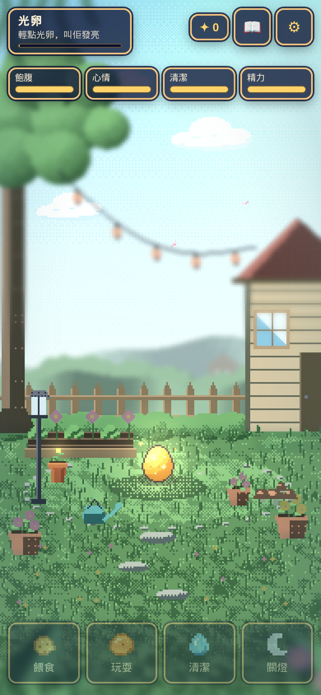
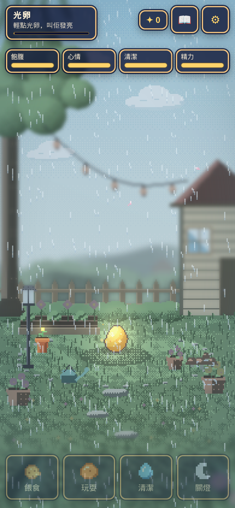
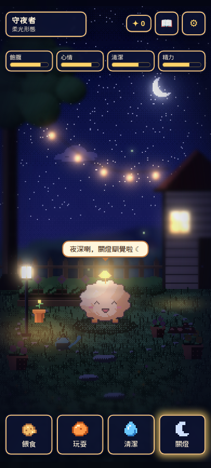
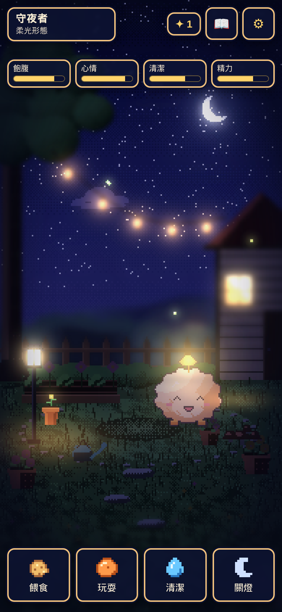
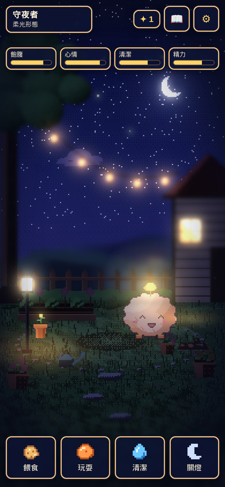
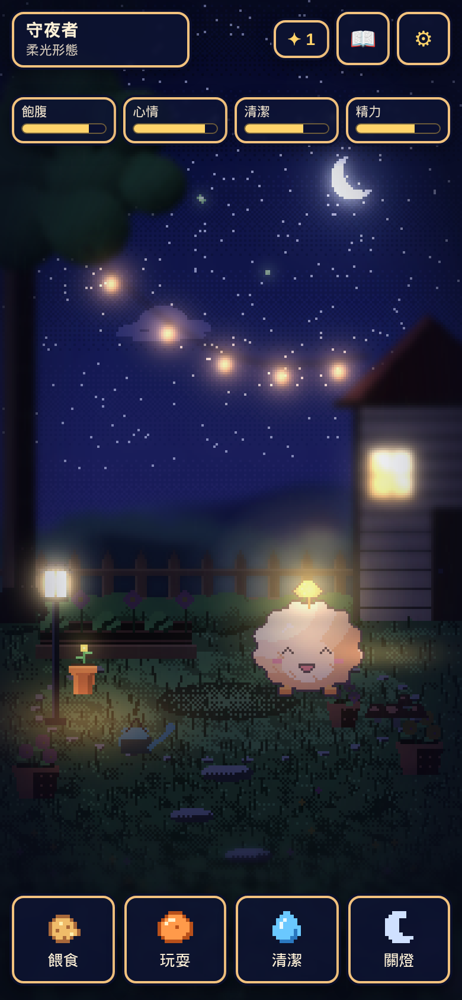
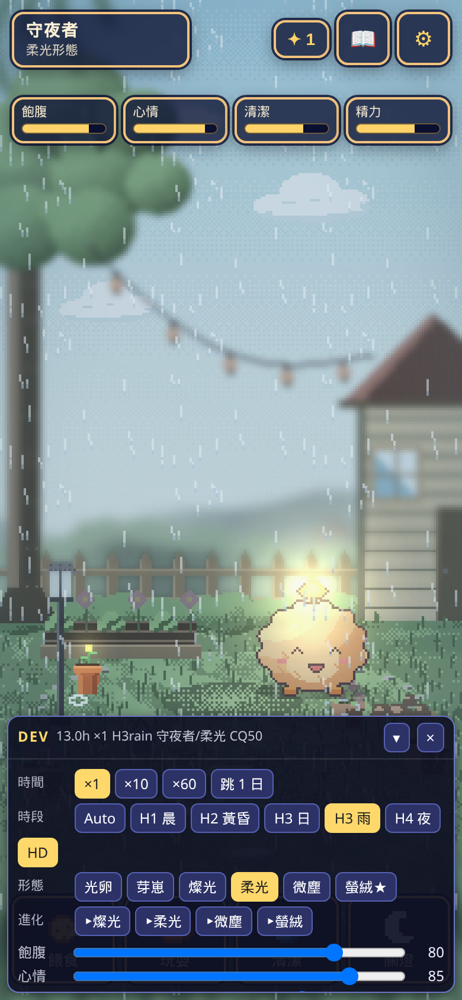
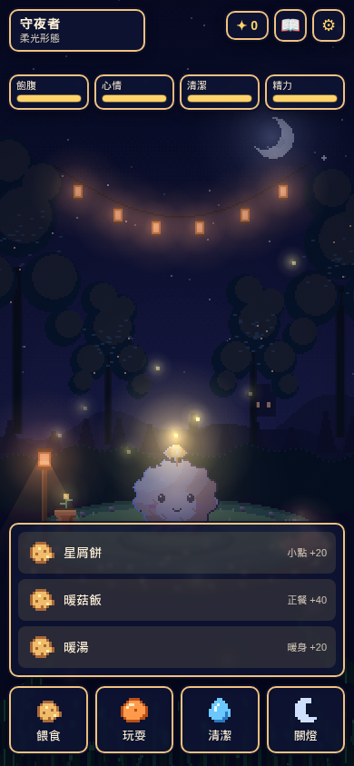

# QA 實測報告：微光小圃方案 A（PR #17）

> 對照：遊測計劃 `pet-deepening-test-plan.md` **v5.1**（2026-10-26 定案）。
> 被測：PR #17 `code/glimmer-plan-a` @ `05646e3`（`src/glimmer-a/`，HTML5 Canvas，無 build）。本分支**只加 QA 產出**，冇改遊戲碼、冇推 `main`、冇動 PR #17。
> 日期：2026-10-26（第一輪）。第二輪：2026-10-31，head **`6e89d88`**。第三輪：2026-10-31，head **`5497595`**。第四輪：2026-10-31，PR #17 **`021726b`**、生命感 **`2700494`**、音訊 PR #16 **`59ecf7d`**。規模：6 種作息 × **3000 日** × **8 seed**（7／3／5／11／13／17／19／23），時區 `Asia/Hong_Kong`。
> 工具：沿用 `tests/pet/qa_glimmer_r3.js`、headless Chrome（`window.__qa.pet`）、`tests/liveliness/run.mjs`（呢部機冇 Playwright 自帶 Chromium，版面改用系統 Chrome）。第四輪數字：`tests/pet/out/glimmer_build_r4.json`、`tests/pet/out/glimmer_pw_r4.json`、`tests/pet/out/rain-59ecf7d.json`。
> 第四輪冇改遊戲碼，冇推 `main` 或開發分支。第三輪段落仍然係 `5497595`。
> 第五輪：2026-10-31，合併包 PR #22 `code/glimmer-combo` **`6a29a93`**。第六輪：同日 head **`b4a5616`**（已合併生命感 `497404f`，pity lead 30h）。
> **新規格（設計，第六輪起）**：每日玩家彩虹最長 ≤14 日；隔日玩家 ≤14 日＋一個開 app 週期（隔日 ≈14.05 算 PASS）。雨景比晴 H3 暗約 18% 係設計，算 PASS。

## Round 6 – combo b4a5616

被測 `b4a5616082546ead55e0d3294e1ece6c79132ef2`（`dist/glimmer-combo.html`，合併 `497404f`）。祖先包含 `000fc5d`。`rainbowPityLeadH` **30**。冇改遊戲碼。

### 1. 彩虹（3000 日 × 8 seed）

| 作息 | 平均（min–max，括號平均） | 最長 | 新規格 |
|---|---|---|---|
| 勤力 | 12.66–12.77（12.72） | 13.151 | PASS（≤14） |
| 一般 | 12.66–12.77（12.74） | 13.211 | PASS |
| 上班族 | 12.71–12.77（12.74） | 13.168 | PASS |
| 輕度 | 12.71–12.82（12.75） | 13.152 | PASS |
| 早鳥 | 12.71–12.77（12.73） | 13.147 | PASS |
| 隔日 | 12.77–12.88（12.80） | **14.047** | PASS（≤14＋一個開 app 週期） |

240h 冷卻違規 **0**。平均全部 11–15。池 **2.254–2.391**，總 **≤2.834**。14 日日記平均 **31.04**（連彈窗 33.04）。

### 2. 套件（pass／fail／skip）

| 套件 | 通過 | 失敗 | skip |
|---|---|---|---|
| behavior | **96** | 0 | 0 |
| events | **161** | 0 | 0 |
| e2e-s1 | **51** | 0 | 0 |
| e2e-hd2d | **51** | 0 | 0 |
| e2e-live | **45** | 0 | 0 |
| e2e-a | **94** | 0 | 0 |

### 3. 第五輪回歸（打包頁）

直向清晰畫面 360 **82.1%**、390 **100%**、412 **97.4%**，`#bgfill` 非零 **100%**（冇黑邊）。日記／設定 44.7／45／46.5。橫向 `display:flex` 同「請轉直向」。時段切到 H1／H2／H3／H3rain／H4，mix 1。雨亮度 **160** vs 晴 H3 **194**（約暗 18%，按新規格 PASS）。雨聲 on，xfade **1.5 s**，loop **24.706 s**。DEV 預設關，名牌 5 下打開，切 H2 成功。`tapPet(5)` → `grumpy_tap`、冷卻 **48h**、光粒 **0**、`dayCount` 唔加、面板仍然關。4× CPU：高畫質 H3 平均 **16.64 ms**、p95 **16.7**、long task 1；低畫質雨景同樣 **16.64／16.7**、long task 1。Console error **0**。





第五輪寫嘅「隔日 14.05 未過」同「雨景太暗」兩項 P2，按上面新規格改為 PASS。呢個 commit 冇新 P0／P1／P2。

---

## Round 5 – combo（6a29a93）＋ R4 覆核

被測檔 `src/glimmer-a/dist/glimmer-combo.html`（8.6 MB，自包含）。`tests/liveliness/run.mjs` 要 Playwright 自帶 Chromium，呢部機冇，版面／時段／團絨用系統 Chrome 對住 `window.__qa.pet`。截稿再 `git fetch origin code/glimmer-combo`，head 仍係 **`6a29a93f90e8207d01f8d54676809120a053551b`**，祖先冇 `000fc5d`。

### 1. 直向鋪滿、橫向轉屏

清晰畫面佔 viewport：360×640 **82.1%**（左右各約 32px）、390×844 **100%**、412×915 **97.4%**（上下共 23px）。`#bgfill` 取樣非零 **100%**，當黑邊填滿。dpr 1 同 3 一樣。溢出／裁切 0，掣無重疊。日記／設定：360 **44.7**、390 **45**、412 **46.5**。照顧掣 390 為 86.5×74。Console error **0**。

橫向 844×390、915×412：`#rotate` display **flex**，字「請轉直向」（`pointer: coarse`）。





### 2. 時段 H1–H4、雨、2 秒淡入

假時鐘 0–23 點，下一幀嘅 `hd.current().variant`：

| 鐘 | 場景 |
|---|---|
| 0–5、19–23 | **H4** 夜 |
| 6–9 | **H1** 晨 |
| 10–15 | **H3** 日（`weather=rain` → **H3rain**） |
| 16–18 | **H2** 黃昏 |

H1→H4 crossfade：mix 0.008→1.000 用 **2000.4 ms**。亮度每幀最大跳 **15.7**（中段 mix 0.508），冇一幀彈完。

雨：variant **H3rain**、`rain` 層 true、天氣 rain。環境色 H3 `#f2fbff`、雨 `#bed5e4`。畫面亮度 H3 **192**、雨 **158**（雨**更深**，唔係更淺）。音訊：`amb:rain:start`，`xfadeSec` **1.5**、`xfadeAt` **1.5**、loop **true**、short **6 s**、loop **24.706 s**，AudioContext running。







### 3. 團絨框

成人柔光，實色框（art px）：H1／H2／H4／雨 **48×49 @ (63,245)**，H3 **48×51 @ (63,243)**。闊度相同，高差 2px、y 差 2px（idle 幀），唔係縮放錯位。

### 4. 開發面板

平常 `__qa.dev.isOpen()` **false**。名牌 5 下 → 打開，事件 log **空**（唔係 `grumpy_tap`）。`?dev=1` 一開就開。切 H2 要等繪圖幀：mode／variant 都係 **H2**、mix 1。寵物短點 5 下：`grumpy_tap:tap`、冷卻 48h、`dayCount` 停喺 2、面板仍然關。



### 5. s1 同 P0（combo `6a29a93`，lead 仍係 26h）

眼神拖動有 tx。背後短點：`clip:turn_back`、`turn:L`、dir −1（`turn_back.ready` true）。長按只得 `tap:hold`，冇 `turn_back`。寵物熱區 CSS ≥44。待機 180 秒：blink 5、sway 2、yawn 6。

3000 日 × 8 seed：池 **2.248–2.389**，總 **2.513–2.826**，彩虹平均 **12.75–12.82**（冇 &lt;11），冷卻／間隔／閃光 72h 違規 **0**。14 日日記平均 **31.02**（連彈窗 33.02）。彩虹最長勤力 **14.052**、隔日 **14.045**（呢個 commit 未收 lead 30h）。

### 6. 低畫質 rim、4× CPU

高畫質 12 幀 `rimMask` **+12**。低畫質再 12 幀 `rimMask` **+0**、`rimFallback` **+0**，tint 仍然 +12。

4× CPU、每景 30 秒（dpr 2，390×844）。幀間隔被 60Hz 封頂，高低畫質都係約 **16.7 ms**（p95 **16.7–16.8**）。long task：高畫質 H1–H4／雨 **3／4／6／7／8** 次；低畫質五景都係 **8** 次。Console error **0**。呢組數字係 headless，唔係手機。

### R4 P2 覆核（唔係 combo）

`rainbowPityLeadH` **30**。plan-a `000fc5d` 同生命感 `497404f` 數字一樣（3000 日 × 8 seed）：

| 作息 | 平均日 | 最長日 | 240h 違規 |
|---|---|---|---|
| 勤力 | 12.66–12.77（12.72） | **13.151** | 0 |
| 一般 | 12.66–12.77（12.74） | 13.211 | 0 |
| 上班族 | 12.71–12.77（12.74） | 13.168 | 0 |
| 輕度 | 12.71–12.82（12.75） | 13.152 | 0 |
| 早鳥 | 12.71–12.77（12.73） | 13.147 | 0 |
| 隔日 | 12.77–12.88（12.80） | **14.047** | 0 |

平均全部 11–15，240h 違規 0。開發講最長 13.15：對到勤力 **13.151**，但一般 **13.211**，隔日 **14.047** 仍然過 14。14 日日記 **31.04**。池 2.254–2.391，總 ≤2.834。

行為套件（`process.exit` 已搬到 daylight 之後）：plan-a **81 通過、0 失敗、0 skip**。生命感 **96 通過、0 失敗、0 skip**（包含 16 個 daylight）。

### 仍未收（第六輪新規格已改判）

設計其後寫明：每日玩家彩虹最長 ≤14 日；隔日 ≤14 日＋一個開 app 週期（≈14.05 PASS）。雨景暗約 18% 係故意。下面兩項喺 `b4a5616` 改為 PASS，見 Round 6。

| 級 | 項 | 當時建議 |
|---|---|---|
| **P2（已改判 PASS）** | 雨景實測更暗（192→158）。 | 設計確認係目標，唔使提亮。 |
| **P2（已改判 PASS）** | 隔日最長 14.047 日。 | 屬「14 日＋一個開 app 週期」，唔使再收 pity。 |

冇新 P0／P1。

---

## Round 4（021726b／2700494／59ecf7d）

`021726b`：彩虹冷卻 **240h**（權重維持 1、pity 仍係 14 日提前 26 小時）、`drawChance` **0.33**、連點獨立事件 `grumpy_tap`、日記文案「2 日後作廢」、`.ibtn` 按縮放放大熱區。生命感 `2700494` 已合併呢個 commit，並重建 `src/glimmer-a/dist/glimmer-live-s1.html`（6.88 MB）。音訊 `59ecf7d` 只量 `amb_rain_light_loop.ogg` 同 `amb_rain_light_short.ogg`，**冇人聽過**。

### 1. 彩虹 240h、6 作息 × 3000 日 × 8 seed

平均＝3000／次數。最長＝連續兩次彩虹嘅牆鐘間隔。冷卻違規（含彩虹 240h）**0**，20 分鐘間隔 **0**。

| 作息 | 平均日（min–max，括號平均） | 最長日 | 平均 11–15 | 最長 &lt;14 |
|---|---|---|---|---|
| 勤力 | 12.66–12.82（**12.76**） | **14.052** | PASS | 否 |
| 一般 | 12.66–12.82（**12.75**） | 13.931 | PASS | 是 |
| 上班族 | 12.71–12.77（**12.76**） | 13.931 | PASS | 是 |
| 輕度 | 12.71–12.82（**12.78**） | 13.918 | PASS | 是 |
| 早鳥 | 12.71–12.88（**12.79**） | 13.910 | PASS | 是 |
| 隔日 | 12.77–12.88（**12.82**） | **14.045** | PASS | 否 |

六個平均都喺 11–15，**冇一個低過 11**（唔算太密）。pity 仍然係主要來源，但勤力最長 14.052 日、隔日 14.045 日，**未嚴格少過 14 日**（超出約 1.0–1.2 小時）。其餘四個最長 13.91–13.93。

### 2. drawChance 0.33：池 2.2–2.4，總數 ≤2.95

池＝`draw`＋`pity`。**6／6 PASS**。總數最高 2.826。

| 作息 | 池／日 | 總／日 |
|---|---|---|
| 勤力 | 2.248–2.306（2.276） | 2.696–2.732（2.711） |
| 一般 | 2.255–2.305（2.280） | 2.704–2.763（2.735） |
| 上班族 | 2.264–2.320（2.286） | 2.711–2.773（2.744） |
| 輕度 | 2.270–2.330（2.298） | 2.734–2.784（2.756） |
| 早鳥 | 2.260–2.308（2.287） | 2.765–2.826（2.801） |
| 隔日 | 2.340–2.389（2.358） | 2.513–2.563（2.534） |

### 3. `.ibtn` 熱區（縮放後 CSS px）

日記同設定，三個直向 viewport，dpr 1 同 dpr 3，plan-a 同打包頁數字一樣。重疊面積 0。

| viewport | dpr 1 | dpr 3 |
|---|---|---|
| 360×640 | **44.7×44.7** | **44.7×44.7** |
| 390×844 | **45×45** | **45×45** |
| 412×915 | **45×45** | **45×45** |


### 4. 日記文案

玩家可見（`main.js` toast、`ui.js` 日記警告、打包 html）係「**2 日後作廢**」。全樹搜尋「就快過期」：打包 html **0 次**；介面字串 **0 次**。仲出現喺 `README.md` 改動說明，同 `e2e-a.js` 嘅反向斷言（測試要寫住舊詞先可以禁止佢）。Playwright 打開日記見到「有 1 件小事 2 日後作廢」。

### 5. `grumpy_tap`（plan-a 同生命感 s1 原始碼，另加兩個頁面 `__qa.pet.tapPet(5)`）

Node 兩邊都 PASS：10 秒內 5 下（實測跨 1.25 秒）出 **`grumpy_tap`**，冷卻 **剛好 48h**（`cd.grumpy_tap`），光粒 **0**、心情 **0**，`dayCount` 同 `stats.events` 唔加，`lastAt` 唔郁。需求鬧脾氣冷卻滿 48h 時連點仍然出 `grumpy_tap`；`grumpy_tap` 冷卻中仍然可以 `force('grumpy')`，文案係需求鬧脾氣嗰句，唔係「今次冇光粒」。`grumpy_tap` 唔喺 `D.EVENTS`。頁面 `eventLog` 係 `grumpy_tap:tap`，`dayCount` 停喺 4，光粒唔加；心情少 0.0004 係 0.4 秒需求衰減，唔係獎勵。

### 6. 套件點解係 65／80、21／27

`node tests/behavior.test.js` 印 **65 通過、0 失敗**，跟住 `process.exit`。後面 16 個 `ok()` 永遠行唔到。將 `process.exit` 拆走再跑，呢 16 個 **全部 PASS**。所以係 **skip（行唔到）**，唔係 fail。65+16＝81；若果分母寫 80，係把 daylight 圖檢查計少一個。未計入：

1. 未載入 daylight.json → daylight null
2. setDaylight 載入
3. JSON：4 時段、blendSeconds 1800
4. 遊策時段 → early／noon／dusk／night
5. 各鐘點對應時段
6. 時段穩定後 mix=1
7. blend 30 分鐘 mix 0→1
8. ambientMultiply 線性過渡
9. bloom／vignette 同步 blend
10. 穩定時採用 JSON 數值
11. pet tint＋bg／overlay 檔名
12–15. `bg／light_{early,noon,dusk,night}.png` 存在（4 個）
16. JSON 缺失退返舊 grade

`node tests/audio.test.js` 印 **21 通過、0 失敗**。原始碼 22 個 `ok()`。對住 27，未計入 6 項，**0 個 fail**：

| # | 項 | 分類 | 原因 |
|---|---|---|---|
| 1 | 音訊檔同遊音 staging 逐檔 sha256 | **skip** | `/workspace/遊音-staging/audio` 唔存在，`ok()` 冇執行 |
| 2–5 | `sfx_coin`、`sfx_hit`、`sfx_lose`、`sfx_win` | **skip** | 只係印「未接駁」，冇斷言 |
| 6 | `amb_rain_light_loop`／`_short` | **skip** | `audio.test.js` 冇呢兩項 |

### 7. 細雨環境聲（只係量度，冇聽）

ffmpeg 解碼＋ebur128＋numpy。同 README 7.10 對長度／LUFS／true peak 一致。**呢度唔判斷「聽落似唔似雨」。**

| 檔 | 長度 | LUFS I | true peak | 樣本峰 | 重心 | 1–8 kHz 能量 | 接縫 | 重複 |
|---|---|---|---|---|---|---|---|---|
| loop | 24.706 s（1,089,529 樣本，44.1 kHz 立體聲 Vorbis） | **−24.0** | **−6.5 dBTP** | −6.5 dBFS | **1761 Hz** | **39.1%** | 接縫步長只係樣本差分 p99.9 嘅 0.02／0.16 倍 | 自相關最高 **0.15**（1.32 s）；半段相關 −0.01 |
| short | 6.000 s（264,600） | **−24.0** | **−8.3 dBTP** | −8.67 dBFS | **1916 Hz** | **42.8%** | 首尾樣本 ≈0；0–0.1 s RMS −75 dB，1.5–4 s −27 dB，5.9–6 s −79 dB | 0.4 s 相關 0.52（淡入包絡）；半段相關 0.00 |

頻帶（loop）：0–200 Hz 12.5%、200–1000 Hz **48.3%**、1–8 kHz 39.1%、8 kHz 以上 0.2%。1–8 kHz 入面局部高出中位數 ≥8 dB 嘅峰有多個，最高約 **11 dB**，分散喺 1.5–7.9 kHz，唔係一條哨音。相對「典型細雨＝寬頻噪音、能量主要喺 1–8 kHz、冇強純音」：純音同接縫、重複都符合；**能量主體喺 1 kHz 以下，唔係 1–8 kHz**。

### 仍未收

| 級 | 項 | 修法 |
|---|---|---|
| **P2** | 彩虹最長間隔勤力 **14.052** 日、隔日 **14.045** 日，pity「≤14 日」未嚴格守住。平均 12.75–12.82 已入 11–15。 | `rainbowPityLeadH` 26→**30**，令窗早約 4 小時開；再跑同一套 3000 日×8 seed，六個最長都要 &lt;14。 |
| **P2** | 細雨量度：重心約 1.8 kHz，1 kHz 以下約六成能量。接縫同重複冇問題。未聽過。 | 合成濾波上移，令 1–8 kHz 成為主能量，再用量度腳本對一次（仍然唔當耳測）。 |
| **P2** | `behavior.test.js` 喺 daylight 16 項之前 `process.exit`，套件永遠報 65。 | 刪走提早 `process.exit`，等 16 項計入總數。 |

冇新 P0／P1。第三輪嘅早鳥池抽取、隔日池抽取、36px 熱區、日記「就快過期」、彩虹平均低過 11，呢一輪都收到。

---

## Round 3（5497595）

`5497595` 收第二輪未收項：回撥日 `offlineReplay` 睇 `noDrawDay`、`lastSaveTime` 超前當日跳保底、`lastSeen` 只可向前、離線補抽唔計 `dailyMax`、早鳥 05–09 命中 ×1.1、彩虹權重 4→1 加 14 日 pity（提前 26 小時）、閃光日 72 小時冷卻。QA 冇改遊戲碼。單元測試：`events.test.js` **154／154**、`behavior.test.js` **63／63**、`sim.test.js` **85／85**。時鐘案例 **14／14**。Node 連點／輕喚醒／壞日記通過。Playwright 直向三個 viewport 無溢出、無裁切、無重疊；橫向係置中直向條，冇改成橫向排版。

### 逐項

| 項 | 結果 |
|---|---|
| P0 回撥 >120 秒（`noDrawDay`）離線補抽唔出事件 | **PASS**。CG-21b：`p_hit=1`、追回 5 小時，事件 **0**、`suppressed` true。119／120 秒對照當日有事件。Playwright 同一條路徑 `offLog` **0**、保底 `null`。人為把 `lastSeen` 拉後 5 小時先會派需求禮物 +5（光粒，唔係事件）；`G.save` 唔會製造呢段缺口。 |
| P1 前撥重設（`lastSaveTime` > now+24h）同一次開啟冇保底 +3 | **PASS**。CG-17／CG-08：`tampered`、離線 `T=0`、`gift=0`、`grainsAfterNoteOpen=0`、`noteOpenEvent=null`。Playwright +25h 同樣光粒 0、冇事件。 |
| P1 `G.save` 唔拉後 `lastSeen`，恢復後冇離線禮物 | **PASS**。回撥 30 分鐘之後 `G.save`：`lastSeen` 同 `lastSaveTime` 都停喺原時鐘。撥返之後 `T=0`、離線禮物 0、`offLog` 0。`applyOffline` 喺 `now < lastSeen` 亦唔拉後。 |
| 池抽取 2.2–2.4／日（6 作息，包括早鳥） | **早鳥 PASS，隔日 FAIL**。早鳥 **2.323–2.389**（平均 2.350）。勤力 2.330–2.365、一般 2.319–2.374、上班族 2.320–2.375、輕度 2.337–2.374，全部入帶。隔日 **2.406–2.438**（平均 2.421），8 個 seed 都高過 2.4。 |
| 總事件 ≤2.95／日 | **PASS**。2.584–2.885。最高係早鳥 2.885。 |
| 每日上限 4：上線計、離線補抽唔計 | **PASS**。上線傍晚 5 種事件、`p_hit=1`，池抽取停喺 **4**（`dayCount=4`）。離線強制補抽單日 **7**（七種各一）。冷啟動 1000×14 日：單日最高 **7**，超過 4 嘅日數 **606**。長模擬上線單日池抽取最多 2（每次只開 180 秒）。 |
| 彩虹 11–15 日、pity 14 日；平均 <11 就要標太密 | **太密，FAIL**。8 seed 平均：勤力 **10.58**、一般 **10.62**、上班族 **10.58**、輕度 **10.64**、早鳥 **10.53**、隔日 **10.94**，六個都 <11。seed 範圍 10.14–11.32（得隔日有個別 seed ≥11）。連續間隔最長 13.91–13.95 日，隔日 **14.005** 日（約多 7 分鐘，離線步長 10 分鐘）。pity 佔彩虹約 55–57%。開發者 `sim-report.js` 56 日×300 種子報平均 11.3–12.0、最長 13.93：最長同今次一致；11.3–12.0 係短窗（開頭冷卻未滿，彩虹較疏）。3000 日穩態低過 11。 |
| 閃光日 72 小時、其餘冷卻、20 分鐘間隔 | **PASS**。8×6×3000 日冷卻違規 **0**、間隔違規 **0**、閃光牆鐘違規 **0**。閃光最短牆鐘間隔：上班族 **81.3 小時**（其餘作息 91–96 小時；隔日樣本疏，最短 1728 小時）。 |
| 14 日離線日記約 31（連彈窗約 33），≤50，彈窗 ≤2 稀有優先 | **PASS**。冷啟動 1000：日記平均 **31.77**、中位 32、p95 38、最多 **45**（≤50）。連彈窗 **33.77**（2.41／日）。稀有優先違規 **0**、彈窗超過 2 **0**。暖機後再缺席 14 日（40 次）：日記 **31.63**、彈窗 **2.00**、合計 **33.63**，稀有違規 0。開發者腳本：日記 31.8、連彈窗 33.8、彈窗最多 2、冷卻違反 0。 |
| 螢火傍晚佔比（權重 14） | **PASS（仍然合理）**。理論份額 **23.9%**（17 點 25.5%、19–21 點 21.5%、22 點 29.8%）。體驗：隔日 29.2%、上班族 32.4%、輕度 32.9%、一般 35.6%、早鳥 37.5%、勤力 37.6%。同第二輪 27.9–37.2% 同一帶，冇返去第一輪嘅 46–61%。 |
| 壞日記／缺 `byId` | **PASS**。Node `noteOpen` 唔拋。Playwright 非 JSON、日記字串、`[null]`、缺 `byId` 都開到 `__qa.pet`，`pageerror` 0。 |
| 連點 5 下 → 鬧脾氣 48 小時 | **PASS**。Node：`tantrumReq=1`、事件 `grumpy`／`tap`、冷卻 **剛好 48 小時**、狀態 `grumpy`。Playwright `__qa.pet.tapPet(5)` 後 `eventLog` 係 `grumpy:tap`，冷卻 47.9999 小時（`step(0.3)` 食咗約 0.3 秒）；狀態顯示 `event`，因為事件演出蓋住行為狀態。 |
| 睡眠點擊輕喚醒 | **PASS**。Node：`lightWake`、表情 `tired`、唔鬧脾氣、需求同光粒不變。睡眠中連點 5 下只係 `sleepStir`。Playwright `tapPet`：`sleeping=false`、表情 `tired`。 |
| 直向 360×640、390×844、412×915 | **溢出／裁切／重疊 PASS；點擊目標 FAIL**。三個 viewport `scrollWidth` 等於視窗、按鈕視覺框冇出界、互相重疊面積 0。四個照顧掣：360 為 65.6×56.1，390／412 為 86.5×74，都 ≥44。日記同設定 `.ibtn`：390／412 係 **36×36**，360 縮放後 **27.3×27.3**。餵食選單三行高 46，同底欄重疊 0。 |
| 橫向 844×390 | **PASS（唔係橫向排版）**。畫面係置中直向條 180×390（`scale(0.462)`），左右留空。冇「請轉直向」字。按「橫向排版先算 bug」，呢項過。掣被縮到日記 16.6px、照顧掣約 40×34，只係橫向附帶，唔當橫向排版失敗。 |

### 3000 日（8 seed 嘅 min–max，括號平均）

池＝`draw`＋`pity`（彩虹 pity 佔用抽選格），排除鬧脾氣同閃光日。總＝池＋鬧脾氣＋保底。彩虹間隔＝3000／次數。

| 作息 | 池／日（2.2–2.4） | 總／日（≤2.95） | 彩虹日（11–15；平均&lt;11＝太密） | 最長間隔 | 螢火傍晚 | 冷卻 | 間隔 | 閃光 72h |
|---|---|---|---|---|---|---|---|---|
| 勤力 | 2.330–2.365（2.348）PASS | 2.748–2.780（2.769）PASS | 10.38–10.87（**10.58**）太密 | 13.91 | 37.6% | 0 | 0 | 0 |
| 一般 | 2.319–2.374（2.335）PASS | 2.766–2.822（2.783）PASS | 10.31–10.87（**10.62**）太密 | 13.93 | 35.6% | 0 | 0 | 0 |
| 上班族 | 2.320–2.375（2.350）PASS | 2.772–2.835（2.800）PASS | 10.45–10.79（**10.58**）太密 | 13.95 | 32.4% | 0 | 0 | 0 |
| 輕度 | 2.337–2.374（2.357）PASS | 2.796–2.819（2.807）PASS | 10.14–10.95（**10.64**）太密 | 13.95 | 32.9% | 0 | 0 | 0 |
| 早鳥 | 2.323–2.389（2.350）PASS | 2.822–2.885（2.852）PASS | 10.34–10.75（**10.53**）太密 | 13.92 | 37.5% | 0 | 0 | 0 |
| 隔日 | 2.406–2.438（2.421）**FAIL** | 2.584–2.614（2.594）PASS | 10.64–11.32（**10.94**）太密 | 14.01 | 29.2% | 0 | 0 | 0 |

零事件日：輕度 0.24–0.51%（≤3%），早鳥 0.10–0.34%，每日 ≥3 次嘅作息 ≤0.27%，隔日 0%。閃光日 2.2–3.2%。

### 仍未收

| 級 | 項 | 修法 |
|---|---|---|
| **P1** | 彩虹穩態平均 **10.53–10.94 日**，六個作息都低過 11（太密）。pity 守到約 14 日，自然抽出（權重 1、約佔 55%）拉低平均。開發者 11.3–12.0 係 56 日短窗。 | 彩虹權重 **1→0**（淨係 14 日 pity，提前 26 小時），或者冷卻 **72h→約 240h**。改完再跑同一套 3000 日×8 seed，六個平均都要 ≥11 而且 ≤15。 |
| **P2** | 隔日池抽取 **2.406–2.438**／日，高出 2.4。其餘五個入帶。總數仍然 ≤2.95。 | `drawChance` **0.34→0.33** 再量：隔日要 ≤2.40，其餘五個仍然 ≥2.20。 |
| **P2** | 日記、設定掣設計尺寸 36px。390／412 實測 36×36，360 實測 27.3×27.3，低過 44。照顧掣達標。 | `.ibtn` 加到 44，並且 `layout()` 縮放之後熱區最短邊維持 ≥44px（360 嘅 scale 約 0.76，只改設計尺寸唔夠）。 |
| **P2** | 日記提示仍然係「就快過期」，未寫「2 日後作廢」。防重複仍然只打最後 1 個。 | 文案寫剩餘日數；`hist` 最後兩個都 ×0.25。 |

冇新 P0。第二輪 P0（回撥日補抽）同 P1（重設保底、`lastSeen`）呢一輪收到。

### 畫面

直向三個尺寸都係同一直向版面，冇裁切。412×915 左右各留約 11px。橫向 844×390 係窄直向條置中，左右大塊空，冇橫向重排。




### 點樣重跑

```bash
git fetch origin code/glimmer-plan-a   # 5497595
# 遊戲樹自己 checkout，唔好將 QA commit 推去 code/glimmer-plan-a 或 main
python3 -m http.server 8137 --bind 127.0.0.1 --directory src/glimmer-a
TZ=Asia/Hong_Kong node tests/pet/qa_glimmer_r3.js \
  --src src/glimmer-a --days 3000 --seeds 7,3,5,11,13,17,19,23 \
  --json tests/pet/out/glimmer_build_r3.json --whatif 0
node tests/pet/qa_glimmer_pw_r3.js --url 'http://127.0.0.1:8137/index.html?seed=7' \
  --json tests/pet/out/glimmer_pw_r3.json --shots QA/shots
TZ=Asia/Hong_Kong node src/glimmer-a/tests/sim-report.js
node --test src/glimmer-a/tests/events.test.js src/glimmer-a/tests/behavior.test.js src/glimmer-a/tests/sim.test.js
```

全套 3000 日約 51 秒（`--whatif 0`）。

---

## Round 2（6e89d88）

遊程把第一輪 P0／P1 收進 `6e89d88`（離線按日補抽最多 14 日、彈窗稀有優先、保底唔打穿冷卻、權重對齊 v5.1、螢火 20→14、壞檔修補、連點 5 下＝48 小時鬧脾氣、睡眠輕喚醒）。QA 用自己嘅 harness 對住真 `events.js`／`sim.js` 再跑，同時跑咗佢哋嘅 `tests/sim-report.js`（結果同冷啟動 14 日一致）。單元測試：`events.test.js` **126／126**、`behavior.test.js` **63／63**、`sim.test.js` **82／82**。

### 對上一輪：逐項 PASS／FAIL

| 項 | 第一輪 `05646e3` | 第二輪 `6e89d88` |
|---|---|---|
| 池抽取／日 2.2–2.4 | FAIL 0.49–2.15 | **大致 PASS，早鳥未入帶**。勤力 2.219–2.259、一般 2.197–2.254、上班族 2.227–2.257、輕度 2.228–2.261、隔日 2.291–2.333。早鳥 **2.174–2.226**（平均 2.207，8 個 seed 有低過 2.2）。一般最差 seed 2.197，其餘 ≥2.2。 |
| 總事件／日 ≤2.95 | PASS（因為太少） | **PASS** 2.47–2.73 |
| 彩虹 11–15 日（全部作息，包括隔日） | FAIL（勤力／一般／上班族約 8–9 日；隔日約 30 日） | **未全 PASS**。勤力 12.2–13.8、一般 12.1–13.9、上班族 12.7–14.4、輕度 12.6–**15.0**。早鳥最高 **15.46**、隔日最高 **15.71**（各 1–2 個 seed 高出 15，其餘入帶）。 |
| 螢火佔傍晚 17–23 | FAIL 45.6–61.1%（權重 20） | **PASS（權重 14 已上）**。理論份額 22.7%。體驗：隔日 27.9%、上班族 31.1%、輕度 32.2%、一般 35.2%、早鳥 37.2%、勤力 37.2%（8 seed 百分比平均）。比第一輪疏好多；勤力／早鳥仍高過理論，係 24 小時冷卻拉高，唔係權重冇改。 |
| 14 日缺席日記約 31（連彈窗約 33），上限 50 | FAIL（約 0.07 條） | **PASS**。冷啟動 1000 種子：日記平均 **30.64**、中位 31、p95 37、最多 41（&lt;50）。連彈窗平均 **32.64**（2.33／日）。領取光粒平均 **91.92**（＝條數×3；單次上限 60，要領兩次）。戳記係發生時間，唔係返嚟時間（`tsCollapsed=0`）。暖機後再缺席 14 日（40 次）：日記 30.48、彈窗 2.00、合計 32.48。21／30 日缺席仍然約 33，因為只補最近 14 日。開發者 `sim-report.js`：日記 30.6、中位 31、連彈窗 32.6，同 QA 一致。 |
| 彈窗稀有優先、最多 2 | FAIL | **PASS**。1000 次冷啟動同 6 作息×8 seed 稀有優先違規 **0**、彈窗超過 2 次 **0**。 |
| 保底／fallback 唔打穿冷卻 | FAIL（約 0.08–0.37 次／日，禮物／尋寶） | **PASS（24 小時／48 小時）**。8×6×3000 日入面，非閃光事件冷卻違規 **0**。 |
| 冷卻／間隔違規 0 | 間隔 PASS；冷卻 FAIL | 間隔 **PASS（0）**。24h／48h **PASS（0）**。閃光日當稀有 72 小時計有 **45** 次（全部係 `flash`，間隔 24–71 小時）：閃光日按日期派，**冇查 72 小時冷卻**。見 P2。 |
| 輕度零事件日 ≤3% | PASS 0.52–0.82% | **PASS** 0.44–0.55%。早鳥 0.14–0.27%。每日 ≥3 次嘅作息 0–0.30%（≤1%）。隔日 0–0.07%。 |
| 連點 5 下／10 秒 → 48 小時鬧脾氣 | FAIL（只係 3 秒動畫） | **PASS**。`behavior.tap('pet')`×5 同一幀 → 狀態 `grumpy`、`tapTantrum` 事件、冷卻剛好 48 小時。對應 `__qa.pet.tapPet(5)` 入面嗰條 `tantrumReq` 路徑（main.js 每幀交俾 `EV.tapTantrum`）。 |
| 睡眠輕喚醒 | FAIL（只吐司） | **PASS**。`toggleSleep` 之後 `tap('wake')`：`lightWake`、表情 `tired`（睏睏）、唔鬧脾氣、需求同光粒不變。睡眠中直接連點 5 下只係 `sleepStir`，狀態保持 `simsleep`。 |
| 壞日記／缺 `stats.byId` | FAIL 開波拋錯 | **PASS**。`diary` 字串、`[null]`、`stats` 冇 `byId`、`claimedFlashDates` 係數字，`noteOpen` 都唔再拋。 |
| 時鐘 119／120／121、+23h59m、+24h、+25h、DST／時區 | 邊界 PASS | **邊界仍然 PASS**（119／120 唔判、121 判、+23h59m 同剛好 +24h 有效、+24h10s 同 +25h 重設、DST 秋／春同 HKT→洛杉矶唔誤判）。**新缺口見 P0-R2。** |

### 每日上限 4（上線 vs 離線）

- **上線仍然封頂 4。** 傍晚 19:00 起、命中率強制 1、每 15 分鐘抽一次，時段內有 5 種事件（禮物、流星、彩虹、螢火、尋寶），實測池抽取停喺 **4**，`dayCount=4`。長模擬入面上線池抽取單日最多 2（開 app 只有 180 秒，自然唔會頂到 4）。
- **`6e89d88` 嘅離線補抽仍然食同一個上限。** `offlineReplay` 仲有 `if (E.dayCount >= P.dailyMax) continue`。1000 次 14 日入面，單日事件最高 **剛好 4**，超過 4 嘅日數 **0**。日記條數已經係預期嘅約 31／連彈窗約 33，因為自然速率約 2.3／日，上限 4 只係截走尾部。
- 宣佈會再推「離線補抽唔計入每日上限」。截稿時 origin 未見新 commit。嗰個 commit 上咗之後，要再量離線單日係咪可以 &gt;4，同埋池抽取／日記平均有冇被尾部拉高。而家嘅 3000 日**唔包括**該改動。

### 第二輪仍未收

| 級 | 項 | 建議 |
|---|---|---|
| **P0** | **回撥 121 秒當日，離線補抽仍然出事件。** `noteOpen` 會設 `noDrawDay`，`suppressed()` 係 true；但 `offlineReplay` 唔睇呢個旗，追回同一日仍然抽出禮物／尋寶／螢火（CG-21b：2 件、光粒 +15、sup 仍然 true）。119／120 秒對照可以抽，符合容差。玩家真實路徑係開 app → `applyOffline` → 補抽，所以「篡改當日唔抽」而家守唔到。 | `offlineReplay` 開頭如果 `noDrawDay` 等於今日 UTC 日，就唔補抽、唔派彈窗。 |
| **P1** | **`lastSaveTime > now+24h` 重設之後，同一次 `noteOpen` 仍然保底 +3**（CG-17／CG-08，`grainsAfterNoteOpen=3`，事件 `gift`）。離線段本身 T=0、禮物 0，呢部份達標。 | 重設嗰一次開啟跳過保底。 |
| **P1** | **`G.save` 仍然把 `lastSeen` 寫成而家，`markSave` 又唔拉低 `lastSaveTime`。** 回撥 30 分鐘期間存檔，時鐘恢復後 T=30 分鐘、離線禮物 **+1**，而且因為「而家」已經唔早過 `lastSaveTime`，`suppressed` 係 false。 | 判篡改時 `lastSeen` 唔好早過 `lastSaveTime`。 |
| **P1** | **早鳥池抽取 2.174–2.226／日**，未成帶喺 2.2–2.4。一般最差 seed 2.197。 | 早鳥朝午開 app，缺口補抽係主來源；對吓 07:30／12:30 前後嘅時段覆蓋。差 0.03 以內嘅 seed 可以當抽樣，早鳥成組偏低要再睇。 |
| **P2** | 彩虹：早鳥最高 15.46 日、隔日最高 15.71 日（3000 日、8 seed 入面少數）。其餘作息喺 11–15。 | 若要 8／8 seed 都入帶，微調彩虹權重或再加種子先好話係系統性偏慢。而家更似抽樣尾。 |
| **P2** | 閃光日唔查 72 小時冷卻（45 次／14.4 萬日）。兩日內兩個閃光日會連派。規格係按日期 3% 領一次，同「稀有 72 小時」撞車。 | 二揀一寫死：閃光日只跟日期，或者派之前查 72 小時。 |
| **P2** | 日記警告仍然係「就快過期（日記只留 14 日）」，未寫「2 日後作廢」。防重複仍然只打最後 1 個，唔係最近 2 個。 | 文案同 `hist` 最後兩個 ×0.25。 |

第一輪 P0-1 至 P0-6、P1-1（螢火權重）、P1-2（連點事件）、P1-5（日記戳記同 14 日條數）、P1-6（隔日零事件）、壞檔，呢一輪都收到。P1-3、P1-4 未收。P1-7（閃光計入 `dayCount`）未再單獨量；上線封頂測試開咗 `gDone` 同 `flashDone`，量到嘅係池抽取本身。

---

## 0. 一句結論（第一輪 `05646e3`，已被上一節取代）

出貨引擎嘅**時鐘邊界本身達標**（119／120 秒唔判篡改、121 秒判、+23h59m 同剛好 +24h 仍然有效、+25h 重設、DST／換時區唔誤判），閃光日約 3%，全域 20 分鐘間隔違規 **0**，貼圖預算 **PASS**。但事件時鐘只用「有效離線時間」、上限 **12 小時**，所以池抽取全日低過 2.2–2.4，隔日玩家彩虹約 30 日先一次，缺席 14 日幾乎冇日記。再加上保底可以無視 24 小時冷卻、離線彈窗唔係稀有優先、壞存檔會喺 `__qa.pet` 掛上之前拋錯、連點鬧脾氣只係 3 秒動畫。傍晚螢火散步佔 **45.6–61.1%**（勤力約 56%），對品種嚟講偏高。

參考模擬 `tests/pet/out/events_results_ref.md`（`pet_events_final.py`，按牆鐘抽全日）**全部 PASS**。下面表格凡寫「出貨」就係真 build；參考模擬唔當作出貨結果。

## 1. 優先級

### P0（上線前必須）

| # | 發現 | 建議修法 |
|---|---|---|
| P0-1 | **事件鐘 ≠ 牆鐘。** `sim.effectiveOffline`：頭 8 小時 100%＋之後 16 小時 ×0.25，再長就唔計，所以每次返嚟事件最多推進 **12 小時**。池抽取：勤力 2.11–2.15、一般 1.95–2.01、上班族 1.70–1.75、輕度 1.36–1.41、早鳥 1.29–1.32、隔日 **0.49–0.51**（目標 2.2–2.4，**6/6 唔達**）。總事件 0.81–2.64，天花板 ≤2.95 係因為事件太少。缺席 1／3／7／14／21／30 日（各 40 次）生成事件都係 **1.5–1.7 件**，日記新增 **0.03–0.17 條**；v5.1 參考係缺席 14 日約 **33 條日記、約 98 光粒**。 | 需求衰減可以繼續用 E。事件補抽要跟牆鐘（或每個錯過嘅本機日抽一次）寫入日記，彈窗仍然最多 2。`offlineMaxEvents` 12、`diaryMax` 30 而家幾乎碰唔到，補抽之後先會生效，要一併驗。 |
| P0-2 | **離線彈窗按生成次序攞頭 2 個，唔係稀有優先。** 例：`firefly_walk` 彈窗、`sleeptalk` 彈窗、`meteor` 入日記。8 seed 稀有優先違規：勤力 14、一般 54、上班族 124、輕度 230、早鳥 226、隔日 184。彈窗數量上限 2 本身守到（`maxPop=2`、`popOver=0`）。 | `offLog` 先排稀有（流星夜、彩虹；同稀有就較新），再取 2 個做彈窗，其餘入日記。 |
| P0-3 | **保底可以打穿 24 小時冷卻。** `events.pick(..., relaxed)` 冷卻內嘅 fallback 用晒就會「只忽略冷卻」。8×3000 日冷卻違規幾乎全部係 `guarantee`：勤力 5138、一般 4909、上班族 7054、輕度 2014、早鳥 8905、隔日 1850（約 **0.08–0.37 次／日**）。抽樣間隔短到 **2.95 小時**（禮物，需要 24 小時）。全域 ≥20 分鐘：**0 違規**。另外少量 `flash` 亦計入冷卻違規（見 P1-7）。 | 冇「條件符合而且冷卻已過」嘅 fallback 就唔好出保底（間隔唔夠就延後或放棄）。出貨單元測試容許保底冷卻破壞 &lt;5%，v5.1 要 **0**。 |
| P0-4 | **彩虹唔喺 11–15 日。** 勤力 7.98–9.12、一般 8.33–8.93、上班族 8.36–9.29 日（太密，因為出貨禮物／蝴蝶／尋寶權重只係 2.2–3，彩虹權重 4 相對好大）。隔日 **29.7–31.25 日**（太疏，主因 P0-1）。輕度 11.28–12.30、早鳥 12.93–14.42 **達標**。 | 採用 v5.1 時段同兄弟權重（見 §2），再跑同一套 harness。隔日要同時修 P0-1，單改權重唔夠（what-if 隔日仍然約 40 日）。 |
| P0-5 | **壞存檔喺開波時拋錯，遊戲循環同 `__qa.pet` 都起唔到，壞檔留喺 localStorage。** Playwright：`diary` 係字串 → `E.diary.filter is not a function`；`diary: [null]` → 讀 `ts`；`stats` 有 `events` 但冇 `byId` → 讀 `'sleeptalk'`／`'gift'`（`events.js` 約第 115 行 `E.stats.byId[def.id]`）。`noteOpen` 喺 `requestAnimationFrame` 同 `window.__qa.pet` 之前。非 JSON `"{` 會 deserialize 成 null 然後開新遊戲（呢個 OK）。 | `ensure()` 檢查 `diary` 係物件陣列、`claimedFlashDates` 係陣列、`stats.byId` 係物件；`noteOpen` 用 try/catch，壞就重建 `evs`。 |
| P0-6 | **連點鬧脾氣唔係 48 小時事件；睡眠點擊唔會輕喚醒。** 規格：10 秒內點寵物 5 次 → 鬧脾氣事件（冷卻 48 小時）；睡眠中連點 → 睏睏、唔扣需求。出貨：`behavior.processTaps` 只係 `grumpyDur` 3.2 秒、`grumpyCooldown` 8 秒嘅狀態，**唔 call** `EV.force`。`ui.js` 睡眠時 `pointerdown` 只吐司「噓…團絨瞓緊」，唔交 `BEH.tap`。Playwright 睡眠用例確認吐司含「瞓」、log 冇 `sleepStir`。引擎側 `Glimmer.behavior.tap` ×5 會去到狀態 `grumpy`，`eventLog` 仍然係 `[]`。 | 5 下／10 秒要發 48 小時事件（同時守 20 分鐘全域間隔）。睡眠 `pointerdown` 呼叫 `BEH.tap`，播睏睏，唔好只吐司。 |

### P1（試玩前應做）

| # | 發現 | 建議修法 |
|---|---|---|
| P1-1 | **螢火散步佔傍晚（17–23）事件 45.6–61.1%**，開發講嘅 56–64% 同勤力／早鳥實測相符，**對品種嚟講偏高**。第二名通常係彩虹（約 15–20%），禮物／尋寶／流星／蝴蝶分晒餘下。權重建議見 §2。只改權重**唔會**拉高池抽取（what-if 勤力池仍然 2.08）。 | 先上 v5.1 兄弟權重同時段；若體驗佔比要落 ~30%，螢火權重再試 **12–13**（外推，未重跑），然後用本 harness 再量。 |
| P1-2 | **需求型鬧脾氣遠低過參考。** 出貨係權重 3 嘅池成員，要 `E.low ≥ grumpyLowSec`（7200 秒＝2 小時；`condOk` 註釋誤寫 ≥1 小時）。勤力只得 **0.023–0.029／日**（參考約 0.21）。天花板 ≤0.40 仍然守到，但觸發語義唔係「需求低滿 2 小時就出」。 | 低需求滿 2 小時就強制事件（48 小時冷卻），唔好同禮物搶權重。 |
| P1-3 | **`lastSaveTime > now+24h` 重設之後，同一次 `noteOpen` 仍然派保底。** +24h10s 同 +25h：離線 `T=0`、離線禮物 0、光粒 0，但隨即保底禮物 **+3**。規格「該次唔派獎」如果包保底，而家未做到。 | 重設嗰一次開啟跳過保底同池抽取；下一次開啟先恢復。 |
| P1-4 | **`G.save()` 一定把 `lastSeen` 寫成而家，`markSave` 又拒絕把 `lastSaveTime` 調早。** 回撥 30 分鐘再撥返：`lastSaveTime` 唔變、`lastSeen` 已被拉後，恢復後離線 **T=30 分鐘、禮物 +1**，事件仍然 suppressed。121 秒回撥嘅 Playwright 亦見到 `lastSeen = T0−121000`、`lastSaveTime` 不變。 | 判篡改時 `lastSeen` 唔好寫早過 `lastSaveTime`；或者 save 同 `markSave` 用同一個下限。 |
| P1-5 | **日記時間戳＝返嚟嗰刻**（`opts.off.now`），唔係事件發生時間，所以年齡由返嚟先開始計；14 日保留／第 12 日警告喺「缺席期間」唔會走。警告文案係籠統「就快過期」，規格要「2 日後作廢」（API 只回條數）。`diaryMax` 30、`offlineMaxEvents` 12 而家係潛在上限，P0-1 修好先會爆。 | 戳記用發生時間；文案寫明日數；補抽上線後再驗 14 日作廢同單次領取 60。領取本身：+3 光粒、心情 0、上限 60（25 條→領 20 條／60 光粒、剩 5）**達標**。 |
| P1-6 | **隔日活躍日零事件 0.60–1.133%**（8 seed 有部分 &gt;1%）。輕度 0.52–0.82%、早鳥 0.47–0.98% **≤3% 達標**；每日 ≥3 次嘅作息 0.13–0.60% **≤1% 達標**。隔日變差係 P0-1 嘅後果。 | 同 P0-1。若產品將隔日都收 ≤1%，而家唔過。 |
| P1-7 | **閃光日計入當日 `dayCount`，註釋話閃光／保底唔計 `dailyMax`。** 冷卻違規入面 `flash`：勤力 66 … 隔日 126（8×3000 日合計）。`claimedFlashDates` 若唔係陣列，非閃光日因為 short-circuit 唔會炸，**閃光日先會炸**（Playwright 抽中嘅日子冇撞上）。 | `dayCount` 只加池抽取；`claimedFlashDates` 喺 `ensure()` 正規化成陣列。 |
| P1-8 | **防重複只打最後 1 個**（`def.id === E.last`），規格係最近 2 個 ×0.25。 | `hist` 最後兩個都乘。 |

### P2

| # | 發現 | 建議 |
|---|---|---|
| P2-1 | 蝴蝶時段 `[7, 18)`，所以 17:00–17:59 會計入傍晚，佔傍晚事件約 **1.2–2.0%**。 | 收到 `[7, 17)` 先同 v5.1 對齊。 |
| P2-2 | 螢火走出 17–23：8 seed 最多 **7 次**（隔日 0）。數量可忽略，但條件門未完全封死。 | 抽中後再驗小時。 |
| P2-3 | `atlas_events` 填充率 24.2%、`atlas_props` 15.9%（尺寸合格，記憶體浪費）。日光貼圖 480×270 係 NPOT；Canvas 2D 唔使補到 2 嘅冪，但若日後改 WebGL 就要補。 | 遊美縮 atlas；NPOT 只係紀錄。 |
| P2-4 | `ui.js` 小遊戲 `pointermove` 條件係 `e.buttons \|\| e.pointerType==='touch' \|\| true`，hover 都會郁籃。冇 `setPointerCapture`。`touch-action: none` 同 `pointerdown`（冇 300ms click 延遲）本身 OK。餵食掣開到 `#pop`。 | 刪 `\|\| true`；拖曳時 `setPointerCapture`。 |
| P2-5 | 日光 tint 嘅低階風險（**只係讀碼，冇量到真機 FPS**）見 §6。 | |
| P2-6 | **已知風險，M1 不當缺陷**：前撥 &gt;24 小時再撥返只損失 1 次開啟；只改時區令本機日期 +1 偵測唔到。 | 計劃已寫明唔處理。 |

## 2. 螢火散步佔傍晚幾多？高唔高？

傍晚＝本機 17:00–22:59 發生嘅事件（池抽取＋保底＋鬧脾氣；閃光日唔計）。佔比係 **8 個 seed 各自百分比嘅平均**。出貨權重：禮物 3（06–24）、蝴蝶 2.5（07–18）、流星 2（19–05，稀有 72 小時）、彩虹 4（17–23，稀有）、螢火 20（17–23）、夢話 2（23–07）、尋寶 2.2（08–22）、鬧脾氣 3（低需求）。

### 2.1 理論權重份額（每個鐘平等，忽略門檻同冷卻）

| 鐘 | 螢火 |
|---|---|
| 17 | 63.1%（禮物 3、蝴蝶 2.5、彩虹 4、螢火 20、尋寶 2.2） |
| 18 | 68.5% |
| 19–21 | 64.1% |
| 22 | 69.0%（尋寶已收） |
| 17–22 合計 | **螢火 65.4%**、彩虹 13.1%、禮物 9.8%、尋寶 6.0%、流星 4.4%、蝴蝶 1.4% |

### 2.2 出貨模擬（3000 日 × 8 seed）

| 作息 | 傍晚事件（seed 7 件數） | 螢火 | 彩虹 | 尋寶 | 禮物 | 流星 | 蝴蝶 | 鬧脾氣 |
|---|---|---|---|---|---|---|---|---|
| 勤力 | 1855 | **56.0%** | 19.0% | 9.7% | 8.2% | 5.3% | 1.8% | 0.1% |
| 一般 | 1770 | **53.8%** | 19.6% | 8.7% | 8.5% | 6.1% | 2.0% | 1.2% |
| 上班族 | 1620 | **52.8%** | 20.2% | 9.1% | 7.4% | 6.2% | 1.2% | 3.2% |
| 輕度 | 1344 | **55.3%** | 19.0% | 6.5% | 9.1% | 5.5% | 1.2% | 3.5% |
| 早鳥 | 1111 | **61.1%** | 19.9% | 6.0% | 4.7% | 5.7% | 1.2% | 1.4% |
| 隔日 | 628 | **45.6%** | 15.8% | 13.8% | 16.2% | 3.4% | 1.4% | 3.8% |

開發講 56–64%：同「權重 65%、再被 24 小時冷卻拉低到勤力約 56%、早鳥約 61%」一致。心情／能量門檻會再幫螢火（蝴蝶要能量 ≥30、尋寶 ≥25、禮物心情 ≥35，螢火冇呢啲門）。

**係偏高。** 傍晚五成以上係同一件事，玩家會覺得晚晚散步。彩虹因為 72 小時冷卻，體感更像「唔係螢火就係彩虹」。

### 2.3 如果改用 v5.1 權重同時段（記憶體改 `D.EVENTS`，**只 seed 7，唔係 8 seed**）

v5.1：禮物 22（07–23）、蝴蝶 20（07–17）、流星 10、夢話 11、尋寶 18、彩虹 4、螢火仍然 20。理論傍晚份額：螢火 **29.6%**、禮物 32.5%、尋寶 22.2%、流星 9.9%、彩虹 5.9%。

| 作息 | 螢火（體驗） | 彩虹間隔 | 池抽取／日 |
|---|---|---|---|
| 勤力 | 42.4% | 13.2 日（入帶） | 2.08 |
| 一般 | 42.4% | 13.0 日 | 1.93 |
| 上班族 | 41.8% | 13.5 日 | 1.71 |
| 輕度 | 43.4% | **17.5 日（稍慢）** | 1.39 |
| 早鳥 | 49.3% | **15.5 日（稍出帶）** | 1.33 |
| 隔日 | 36.5% | **40.5 日** | 0.51 |

體驗佔比 ≈ 理論 × **1.43**（勤力 42.4／29.6）。原因：螢火 24 小時冷卻，但彩虹 72 小時會缺席，日間又往往已經用咗禮物／尋寶冷卻，傍晚剩下螢火。

**建議權重（未重跑，係外推）：** 兄弟先用 v5.1；若想體驗佔比近 30%，螢火由 20 降到 **約 12–13**（`20 × 30/42.4 × 29.6/29.6` 對齊理論份額約 21%，其他權重和約 47.7）。改完必須再跑 8 seed，因為冷卻同門檻會再移位。池抽取低呢件事**唔係權重問題**。

## 3. 改時鐘

比較用 **UTC epoch**。`now < lastSaveTime − 120000` 先算篡改（**剛好 120000 唔算**）。`lastSaveTime > now+24h`（唔係 ≥）先重設。Node harness **14／14 通過**；Playwright 同一組邊界亦通過。

| 案例 | 結果 |
|---|---|
| 回撥 119 秒 | 唔篡改、當日可抽事件 |
| 回撥 120 秒 | 唔篡改、當日可抽事件 |
| 回撥 121 秒 | 篡改、`lastSaveTime` 唔變、`noDrawDay`＝該 UTC 日；時鐘追返當日仍然 **0 事件**（對照 119／120 追返有事件） |
| lastSaveTime = now+23h59m | 仍然有效＝篡改鎖、**唔重設**、離線獎 0 |
| 剛好 +24h00m00s | 仍然有效＝篡改、唔重設 |
| +24h00m10s | 無效→重設為 now、`T=0`、離線光粒 0、之後唔再鎖。**同一次 noteOpen 保底 +3**（P1-3） |
| +25h | 同上；下一次開啟（+8 小時）唔再篡改，`T` 約 8 小時 |
| DST 秋（美東） | 牆鐘 01:30 EDT → 01:10 EST，UTC +40 分鐘，**唔篡改**。Playwright `timezoneId=America/New_York` 同樣 |
| DST 春 | 牆鐘 01:30 → 03:30，UTC 前進 1 小時，唔篡改 |
| HKT 10:00 同洛杉矶同一 UTC +60 秒 | 唔篡改（牆鐘變成前一日 19:01 都唔判） |
| NTP 回撥 30 秒 | 唔篡改 |
| 正常作息誤判 | **0** |

副作用見 P1-3、P1-4。已知風險（前撥日期、只改時區）見 P2-6，不當缺陷。

## 4. 3000 日：彩虹、零事件、池抽取、冷卻、間隔

池＝抽中種類，排除鬧脾氣同閃光日。總＝池＋鬧脾氣＋保底（閃光日唔計）。零事件＝有開 app 嘅本機日入面，冇任何非閃光事件。彩虹間隔＝日數／次數。閃光日係 `hash(saveSeed, date)`、按日期領，約 3%。

數字係 **8 seed 嘅 min–max（括號係平均）**。

| 作息 | 池／日（目標 2.2–2.4） | 總／日（≤2.95） | 鬧脾氣 | 保底 | 零事件日 | 彩虹（11–15 日） | 閃光日 | 冷卻違規 | 間隔違規 |
|---|---|---|---|---|---|---|---|---|---|
| 勤力 6 次 | 2.114–2.151（2.132）**FAIL** | 2.604–2.639（2.62）PASS | 0.023–0.029 | 0.45–0.47 | 0.13–0.37% PASS（≤1%） | 7.98–9.12 **FAIL** | 2.60–3.03% | 5204 | **0** |
| 一般 4 次 | 1.953–2.009（1.97）**FAIL** | 2.500–2.558（2.52）PASS | 0.082–0.094 | 0.46–0.48 | 0.17–0.43% PASS | 8.33–8.93 **FAIL** | 2.60–3.04% | 4975 | **0** |
| 上班族 3 次 | 1.701–1.750（1.73）**FAIL** | 2.309–2.352（2.33）PASS | 0.111–0.120 | 0.47–0.50 | 0.20–0.60% PASS | 8.36–9.29 **FAIL** | 2.61–3.04% | 7122 | **0** |
| 輕度 2 次 | 1.357–1.410（1.38）**FAIL** | 1.995–2.033（2.01）PASS | 0.147–0.153 | 0.47–0.49 | 0.52–0.82% **PASS ≤3%** | 11.28–12.30 PASS | 2.52–2.95% | 2100 | **0** |
| 早鳥 | 1.290–1.322（1.31）**FAIL** | 2.013–2.046（2.03）PASS | 0.123–0.136 | 0.59–0.61 | 0.47–0.98% **PASS ≤3%** | 12.93–14.42 PASS | 2.56–3.04% | 8998 | **0** |
| 隔日 | 0.491–0.511（0.50）**FAIL** | 0.808–0.824（0.82）PASS | 0.064–0.069 | 0.24–0.26 | 0.60–1.13%（見 P1-6） | 29.7–31.3 **FAIL** | 2.2–3.2% | 1976 | **0** |

- **輕度玩家零事件日：達標**（0.52–0.82% ≤ 3%）。早鳥同樣達標。
- 閃光日都喺 3000 日、3% 二項分佈約 3σ（約 2.06–3.94 個百分點）入面。隔日範圍較闊，因為評估次數少。
- 冷卻違規目標 0：**FAIL**（幾乎全部保底，見 P0-3）。間隔目標 0：**PASS**（抽樣最小 20 分鐘）。
- 參考模擬（唔係 build）8 seed：池 2.27–2.39、總 2.65–2.91、彩虹 11.28–14.42、零事件 0.00–0.55%、冷卻＋間隔 0、閃光 3.06–3.33%。全文 `tests/pet/out/events_results_ref.md`。

## 5. 現有測試跑咗咩、邊度失敗

| 測試 | 適用？ | 結果 |
|---|---|---|
| PR 樹 `tests/events.test.js` | 適用 | **106 通過**（退出碼 0）。每日事件帶 1–3 太鬆，抓唔到 2.2–2.4，亦冇要求稀有優先。 |
| PR 樹 `tests/behavior.test.js` | 適用 | **57 通過**。 |
| PR 樹 `tests/sim.test.js` | 適用 | **82 通過**。 |
| `tests/pet/pet_events_final.py`（計劃入面嗰套） | 係**規格模型**，按牆鐘抽，唔係 `events.js` | **全部 PASS**。唔可以當 PR #17 達標。 |
| `tests/art/art_budget_check.py` 對 PR `art/` | 適用 | **PASS**。全部 atlas ≤1024。GPU 解碼（寬×高×4，無 mipmap）：6 張 atlas **6.00 MB**＋8 張日光 480×270 **3.96 MB**＝**9.96 MB**（預算 16 MB）。就算 ×1.33 mipmap 約 13.3 MB 仍然低過 16。WARN：`atlas_events` 填充 24%、`atlas_props` 16%。啟動時三隻形態同全部日光圖都會載入，預算係「全部同時住喺記憶體」計。 |
| `tests/save/save_fuzz.js` | **唔適用**。佢搵 `window.__wr.G`／`windrun_save_v1`（風野競走） | **冇對住微光小圃跑**，避免假失敗。壞檔由 Playwright 同 Node `diaryCases` 覆蓋（P0-5）。 |
| `tests/perf/pet_fps_probe.js` | 要真機幀時間 | **冇跑**。§6 只係讀碼，唔報 FPS。 |
| Playwright `qa_glimmer_playwright.js` | 適用 | **18／23 綠**。3 個紅係壞檔（P0-5）。另外 2 個紅係 **harness**：`__qa.pet.daylight 就緒` 讀咗 `bands[9]`（時段邊界用例本身 PASS）；滑鼠 5 下只中 3 下（座標／節奏），引擎用 `behavior.tap` 重測先算數（P0-6）。載入冇 `pageerror`。 |

`window.__qa.pet` 有 `clock`／`daylight()`／`seed`／`force`／`events`，**冇**計劃寫嘅 `setSystemTime`／`setSaveSeed`／`forceDraw`。測試改為推 `clock` 同直接叫 `Glimmer.events`。

## 6. 日光 tint：低階手機風險（讀碼，冇量機）

畫布邏輯 195×422，顯示整數倍 `k`，最大 4。`daylight.json` 的 `blendSeconds` 1800；遊戲時段 07／11／17／23 **覆蓋** JSON 入面 05:30／09:30／16:00／19:30。`?room=1` 先走烘好嘅圖層；預設唔係 room。

以下係低階機（計劃參考 2 GB Android、4 GB／4 核會當 `lowEnd`）可能嘅熱點。**冇 Chrome Performance、冇真機 FPS，下面唔係測量結果。**

1. **每幀全屏 `multiply`。** `render.js` `frame`：只要日光已載入又唔係 room，**所有畫質（包括 low／off）** 都 `fillRect(0,0,W*k,H*k)`，`dlAmbient` 0.6。`k=3` 已係約 585×1266，`k=4` 約 780×1688。`multiply` 要讀返成張畫布再寫，填充率同頻寬都高。前面仲有一層環境暗色 `fillRect`。低畫質**冇**關掉呢層。
2. **寵物 tint 冇快取。** `tintSprite` 每幀：96×112 離屏，`multiply`＋`lighter`＋`destination-in`＋再一塊 rim（再 `destination-in`／`destination-out`）。約 8 次合成，跟住先貼上主畫布。寵物郁或者只係 mix 變 0.001 都會重做。
3. **高畫質額外讀返主畫布。** `tiltShift` `drawImage(this.canvas)` 係 readback；`bloom` 高畫質 4 級、中畫質 3 級；`blurLayer` 每幀。自動降畫質只睇 rAF 間隔（`windowFrames` 120、`slowMs` 28），**降完仍然留住全屏 multiply**。
4. **疊加過多。** 星／燈／光柱用 `lighter`，每幀再畫一輪光暈 sprite。同 multiply、暗色、暈影疊埋，overdraw 係全屏嘅數倍，唔係只係寵物一個 sprite。
5. **電。** 主循環係 rAF，畫布停唔到（冇「畫面冇變就唔畫」）。日光 mix 每幀都喺變（1800 秒淡入），快取如果用連續 mix 會失效。低階 GPU 成日合成，發熱同掉幀會一齊嚟；掉幀又令自動降畫質更難停。

建議（仍然未量）：

- 時段桶（例如小時×4，層本身已經按呢個重建）先把 ambient 烘入背景層；桶冇變就唔好每幀 `multiply`。
- 寵物 tint 按 clip／幀／方向／mix 桶快取；low／off 用一次 `globalAlpha` 色疊，跳過 rim。
- `deviceMemory≤4` 或 `lowEnd` 時 `k` 封頂 2，並關掉 tilt-shift readback。
- 畫面靜止（寵物 idle、mix 桶冇變、冇粒子）就唔排 rAF，或者降到 10–15 fps；日光淡入可以每 2–4 秒先改一桶，唔使每幀改色。

## 7. 其他行為備註

- 離線需求禮物：離線滿 5 分鐘（`offlineMinAwaySec` 300）先派，約 1 光粒／有效小時。事件被鎖當日，**需求禮物仍然派**（回撥 30 分鐘再恢復：禮物 +1）。如果「篡改當日唔派任何獎」包括呢份，而家未做到；規格正文主要講閃光日同事件。
- 保底係常態：勤力約 0.46 次／日，早鳥約 0.60。v5.1 接受保底 0.25–0.28，出貨高好多，因為池抽唔夠先靠保底填。
- 首次開啟保底同 16:00 保底都在；壞檔發生喺保底之前，所以玩家連保底都睇唔到（P0-5）。
- 喂食掣、載入、時段邊界（06:59 夜、07:00 早、10:59／11:00、16:59／17:00、22:59／23:00）Playwright 通過。`daylight()` 對到 early／noon／dusk／night。

## 8. 點樣重跑

遊戲碼喺 PR #17 工作樹（本分支冇有 `src/`）：

```bash
git fetch origin code/glimmer-plan-a
git worktree add /tmp/glimmer-a origin/code/glimmer-plan-a   # 05646e3
# 靜態頁
python3 -m http.server 8137 --bind 127.0.0.1 --directory /tmp/glimmer-a/src/glimmer-a

TZ=Asia/Hong_Kong node tests/pet/qa_glimmer_build.js \
  --src /tmp/glimmer-a/src/glimmer-a --days 3000 \
  --seeds 7,3,5,11,13,17,19,23 \
  --json tests/pet/out/glimmer_build.json

# Playwright：要已安裝 playwright-core 同本機 Chrome
PW_PATH=/path/to/playwright-core GAME_URL='http://127.0.0.1:8137/index.html?debug=1&seed=7' \
  node tests/pet/qa_glimmer_playwright.js

# 貼圖腳本來自 QA pack（tests/art/art_budget_check.py），唔喺本分支；結果見 tests/art/out/
python3 /path/to/qa-pack/tests/art/art_budget_check.py /tmp/glimmer-a/src/glimmer-a/art
node --test /tmp/glimmer-a/src/glimmer-a/tests/*.test.js
```

`--whatif` 預設會喺記憶體改權重再跑 seed 7（唔寫遊戲檔）。全套 8 seed×6 作息約 3 分鐘。

## 9. 檔案

| 路徑 | 內容 |
|---|---|
| `tests/pet/qa_glimmer_build.js` | 出貨引擎模擬、時鐘、日記、缺席 |
| `tests/pet/qa_glimmer_playwright.js` | headless 時鐘／壞檔／觸控 |
| `tests/pet/out/glimmer_build.json` | 3000 日原始數字 |
| `tests/pet/out/glimmer_pw.json` | Playwright 原始結果 |
| `tests/pet/out/events_results_ref.md` | **參考模擬**（唔係 build） |
| `tests/art/out/art_budget_glimmer_a.md` | 貼圖預算 |
